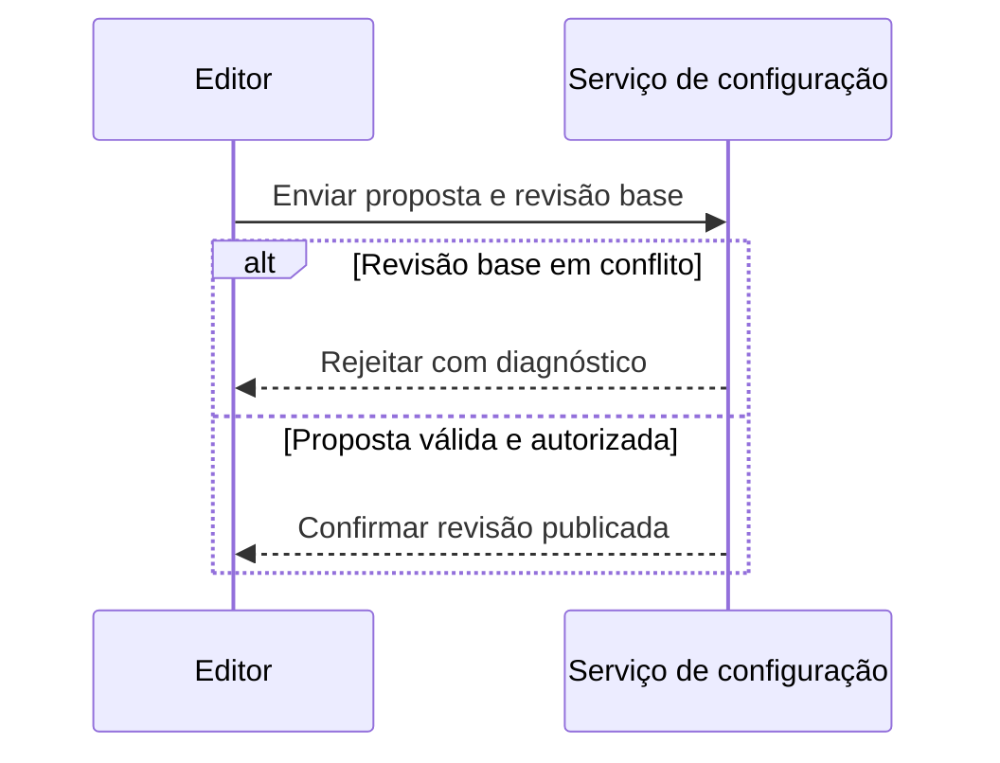

# Mermaid, diagramas e assets

Use ao produzir diagramas ou resolver exportação, iconografia e compatibilidade.
A fonte Mermaid deve continuar editável, versionada e coerente com o contrato.

## Escolha da representação

| Pergunta do leitor | Representação preferida |
| --- | --- |
| Quais componentes existem e onde estão as fronteiras? | Arquitetura Mermaid suportada pelo destino; agrupamentos por responsabilidade e ícones especializados |
| Qual caminho uma operação percorre, incluindo rejeições? | `flowchart` com etapas, decisões, agrupamentos e relações rotuladas |
| Quem envia o quê, em qual ordem e em caso de falha? | `sequenceDiagram` com participantes reais e alternativas/loops relevantes |
| Quais transições são válidas? | `stateDiagram-v2`, incluindo rejeição/recuperação quando especificadas |
| Como entidades e cardinalidades se relacionam? | `erDiagram` para modelo confirmado; modelo proposto identificado como tal |
| Como valores mudam ou se distribuem? | Gráfico de dados reproduzível; Mermaid apenas se expressar adequadamente os dados e for suportado |
| Como executar uma tarefa na interface? | Captura real anotada e passos; mockup explicitamente conceitual quando não existir implementação |

Não use relação bidirecional para ocultar a falta de definição de quem inicia ou
confirma uma ação. Separe configuração, estado, dados e controle por rótulos e
legenda; cor é reforço. Mostre só relações sustentadas pelas fontes e não importe
serviços/clouds adicionais para preencher o desenho.

## Compatibilidade e acabamento

1. Identifique consumidor e versão/capacidades do Mermaid embarcado. Confira a
   documentação oficial para a sintaxe efetivamente escolhida. Uma versão recente
   na máquina local não comprova suporte no portal ou visualizador do repositório.
2. Reutilize tema/tokens comuns e IDs estáveis, com labels curtos e termos de domínio.
   Agrupe por responsabilidade/fronteira, alinhe leitura e reduza cruzamentos.
   Aplique os critérios de [qualidade visual](visual-quality.md).
3. Ícones customizados dependem de suporte do renderizador e registro do pacote;
   colar o identificador de uma biblioteca em Markdown não instala o pacote.
   A API Mermaid oferece `registerIconPacks`; confira a integração existente antes
   de escrever código ou assumir acesso a ela.
4. Diagramas `architecture-beta` possuem sintaxe/capacidades dependentes de versão.
   Não os torne o único acesso à informação quando o destino não tiver suporte
   demonstrado. Use tipo suportado com composição apropriada e exportação refinada.
5. Se o consumidor não permite ícones/temas necessários, mantenha Mermaid como fonte
   lógica e produza uma figura SVG, ou PNG quando necessário, por pipeline local
   reproduzível que aplique os assets aprovados. Incorpore a exportação no documento
   com alternativa textual e acesso à fonte. Não entregue o diagrama genérico bruto
   como se atendesse ao briefing de iconografia especializada.
6. Não mantenha versões semânticas independentes para fonte e exportação. Uma
   composição adicional deve derivar da fonte e de um mapa explícito de assets/
   tokens; registre a geração. Preserve o fluxo de build já adotado pelo projeto.

Registre nome/versão, licença e origem dos ícones. Prefira assets locais licenciados
ou dependências já fixadas; não dependa de CDN não versionada para uma figura crítica.
Evite scripts, HTML arbitrário e redução da política de segurança do renderizador
para obter aparência. Não copie exemplos de instalação como se fossem autorização
para instalar dependências ou enviar dados a serviços públicos.

## Fonte e acessibilidade

Mantenha figuras pequenas inline em bloco `mermaid` quando isso renderizar bem no
destino; figuras reutilizadas/exportadas podem ficar em arquivos `.mmd` junto dos
assets conforme a organização existente. Texto essencial não pode depender da
renderização de Mermaid: forneça explicação estruturada de participantes, relações,
decisões e resultado. Adicione `accTitle` e `accDescr` na sintaxe suportada e confira
se o consumidor preserva a informação; adicione alt/descrição no documento também.

Exemplo **conceitual de notação**, sem ícones: sequência demonstra ordenação e
rejeição; não é um layout enterprise completo, nem contrato do Ec implementado.

A sequência não afirma qual banco, operação de commit ou identidade de revisão
existe. Em uma documentação real, substitua a notação pelo contrato observado e
aplique tokens, legenda e acabamento adequados ao destino. Não force ícones em
notações cujo significado depende de símbolos próprios.

## Validação e atualização

- Compile/renderize no ambiente autorizado com a versão escolhida. Se já existir
  Mermaid CLI, execute-a com os arquivos e configuração reais; documente apenas
  comandos efetivamente disponíveis. Não presuma `mmdc` instalado.
- Inspecione a exportação e a página que a incorpora: fonte de ícones/fontes,
  sobreposições, cortes, contraste, tamanho final, tema, escala e alternativa textual.
  Parser e links válidos não aprovam aparência, acessibilidade ou semântica.
- Preserve fonte, mapa de assets, tokens, dados e comando/versões necessários para
  regerar. Alterou contrato, figura, dado, ícone ou tema? Regenere os derivados e
  repita as verificações afetadas; não atualize só a imagem.
- Sem ferramenta/capacidade, entregue as fontes e explicação e marque a exportação
  ou revisão visual como não verificada. Registre o passo exato para concluir;
  não anuncie compatibilidade ou acabamento visual não observado.

## Documentação oficial consultada

- [Registro de pacotes de ícones](https://mermaid.js.org/config/icons.html).
- [Diagramas de arquitetura e condição beta](https://mermaid.js.org/syntax/architecture.html).
- [Título e descrição acessíveis](https://mermaid.js.org/config/accessibility.html).

Consultada em 2026-11-04. Reconfira capacidades quando mudar a sintaxe ou o
renderizador; a versão do serviço de documentação não fixa a versão do projeto.
