# Ec

Estado observado em 2026-11-05: Server e Agent Rust executáveis, publicação/fila/saída em PostgreSQL via HTTP v1 e frontend Vue 3/TypeScript/Pinia. Os guias de [publicação](docs/development/publication.md), [orquestração](docs/development/orchestration.md), [Agent](docs/development/agent.md) e [frontend](docs/development/frontend.md) delimitam os incrementos locais Linux confiáveis. Segredos por referência e aceite agregado da primeira jornada permanecem pendentes; não há release/implantação remota demonstrada.

**Engenharia de entrega contínua, da configuração ao resultado.**

Plataforma independente de CI/CD planejada para administrar projetos, pipelines, execuções, agentes e entregas de software. Ec Server e Ec Agent serão monólitos modulares Rust; a interface será Vue 3, TypeScript e Pinia.


## Uma plataforma, responsabilidades explícitas

[](docs/assets/diagrams/ec-system.svg)

Arquitetura alvo: o Server coordena e mantém estado operacional; os Agents executam trabalho autorizado. YAML representa configuração desejada. As setas indicam relações conceituais, sem definir endpoints ou topologia implantada.

[Ampliar figura](docs/assets/diagrams/ec-system.svg) · [Fonte Mermaid](docs/assets/diagrams/ec-system.mmd)

## Comece pela sua tarefa

| Quero… | Caminho de leitura |
| --- | --- |
| Conhecer funcionalidades e jornada | [Visão funcional e técnica](docs/architecture/application-overview.md) |
| Entender o que existe e o que falta | [Estado do projeto](sdd/project.md) |
| Localizar uma responsabilidade | [Mapa da aplicação](application/README.md) |
| Fazer e verificar uma mudança | [Guia de contribuição](docs/development/contributing.md) |
| Conferir requisitos e decisões | [Índice da documentação](docs/README.md) e [autoridades](docs/constitution.md) |

## Da autoria à entrega

[](docs/assets/diagrams/delivery-journey.svg)

Jornada planejada: configurar, publicar, submeter, alocar, executar e promover quando aplicável. As revisões de configuração e código são fixadas por execução; gates e políticas precisam de implementação.

[Ampliar figura](docs/assets/diagrams/delivery-journey.svg) · [Fonte Mermaid](docs/assets/diagrams/delivery-journey.mmd)

| Área do produto | Capacidade prevista |
| --- | --- |
| Projetos e configuração | Hierarquia, repositórios, templates e edição equivalente em Visual, Formulário e YAML |
| Pipelines e execuções | Dependências, gatilhos, fila, tentativas, retry e cancelamento explícitos |
| Agentes e infraestrutura | Pools, capacidades, elegibilidade e execução autorizada |
| Resultados e entregas | Logs, testes, artefatos, ambientes, aprovações e deployments |
| Acesso e administração | Pessoas, permissões, integrações, plugins, saúde e auditoria |

As responsabilidades e lacunas de cada área estão na [visão do produto](docs/architecture/application-overview.md). Ec Agent é um executor de CI/CD; seu nome não implica IA.

## Contratos que orientam a implementação

| Tema | Requisito vigente |
| --- | --- |
| Configuração desejada | YAML canônico; Visual, Formulário e YAML preservam a mesma semântica |
| Estado e comunicação | PostgreSQL como autoridade operacional planejada; HTTP versionado entre componentes |
| Publicação e execução | Validação, autorização, revisões imutáveis, leases/fencing e retries explícitos |
| Segurança e experiência | Autorização no backend, segredos por referência, isolamento demonstrado e WCAG 2.2 AA como critério |

O [catálogo de contratos](docs/architecture/contracts.md) detalha fontes, rejeições e especificações pendentes. gRPC/Protobuf e SQLite local continuam propostas. Metas de escala não são capacidade comprovada; efeitos externos não têm garantia de execução exatamente uma vez.

## Verificar este checkout

O acionamento depende de pedido explícito de commit e da escolha `sim`, conforme a
[política canônica](docs/development/task-verification.md). A entrada da suíte é:

```bash
bash scripts/automate.sh run
```

A [política canônica](docs/development/task-verification.md) define pré-requisitos,
evidências e gates SDD. `plan` descreve comandos sem executar tarefas; filtros
pertencem à interface técnica e não substituem a suíte completa no fluxo de commit.
Dependências ausentes bloqueiam, não aprovam. Veja também [scripts/](scripts/README.md).

A integração de scanners usa [comandos nativos da Toolbox](scripts/README.md), com
regras e aprovação no Ec. Configurações STIC e locks de imagens do consumidor
foram retirados. O [registro da migração](docs/validation/toolbox-native-20261108/report.md)
distingue testes de contrato, validações reais e bloqueios de preparo/ativação.
A autorização específica de 08/11 pertence àquela tarefa histórica. Para novas
tarefas vale a política de verificação acima. A [configuração do consumidor](docs/development/verification-tools.md)
segue os guias centrais consumer-integration/application; a
[adequação de 09/11](docs/validation/toolbox-alignment-20261109/report.md) registra
ambiente, proveniência de bases e Checks Bundle, sem execução da suíte.

## Explore o repositório

| Entrada | Conteúdo |
| --- | --- |
| [application/](application/README.md) | Mapas do Agent, Server, frontend e testes entre componentes |
| [docs/](docs/README.md) | Produto, contratos, arquitetura, decisões e guias |
| [sdd/](sdd/README.md) | Workflow, contexto, pontes e evidências |
| [tools/governance/](tools/governance/README.md) | Auditor, instalador e testes Python |
| `config/governance/` | Catálogo, hashes e fontes preservadas |
| [reverse_engineering_teamcity/](reverse_engineering_teamcity/README.md) | Pesquisa histórica e protótipo de referência |

As **67 skills selecionadas** estão instaladas em `.codex/skills/`; não há baseline duplicada; recuperação usa histórico Git/GitHub. Consulte o [procedimento de instalação](docs/development/skill-installation.md) para integridade e recuperação e a [ADR-002](docs/decisions/ADR-002-application-layout.md) para a organização documental.

O produto completo ainda exige contratos e capacidades além dos incrementos descritos nos guias; isolamento de workloads não confiáveis, segredos por referência e implantação remota não estão demonstrados. O código próprio do Ec usa [GPL-3.0-only](LICENSE), conforme a [declaração de licenciamento](docs/development/licensing.md). Não há canal de suporte de produto definido por esta integração.

As figuras descrevem o planejamento. Cada uma possui acesso à imagem ampliada e à fonte editável. O [registro da revisão visual](docs/validation/documentation-enterprise-20261104/report.md) documenta renderização, verificações e manutenção dos assets.

Consulte [organização e retenção do estado local](docs/development/local-state.md) para logs por ferramenta e retenção de somente duas datas em `.local/`.
