# Ec

Atualização de estado em 2026-11-05: existe um incremento Rust executável de parsing/schema e CLI local de validação, com nove testes; publicação, API, PostgreSQL, Agent e frontend funcionais continuam pendentes. Consulte [estado e comandos executados](docs/development/first-functional-journey.md). As descrições de ausência total de código abaixo registram a baseline documental anterior e são superadas por esta atualização apenas quanto a esse incremento. O aceite de governança não é aceite de produto.

**Engenharia de entrega contínua, da configuração ao resultado.**

Plataforma independente de CI/CD planejada para administrar projetos, pipelines, execuções, agentes e entregas de software. Ec Server e Ec Agent serão monólitos modulares Rust; a interface será Vue 3, TypeScript e Pinia.

> **Estado em 2026-11-04 · pesquisa e preparação documental.** Há normas, arquitetura, diretórios da aplicação e ferramentas de governança executáveis. Server, Agent e frontend ainda não têm código de produto, manifests, instalador ou release.

## Uma plataforma, responsabilidades explícitas

[](docs/assets/diagrams/ec-system.svg)

Arquitetura alvo: o Server coordena e mantém estado operacional; os Agents executam trabalho autorizado. YAML representa configuração desejada. As setas indicam relações conceituais, sem definir endpoints ou topologia implantada.

[Ampliar figura](docs/assets/diagrams/ec-system.svg) · [Fonte Mermaid](docs/assets/diagrams/ec-system.mmd)

## Comece pela sua tarefa

| Quero… | Caminho de leitura |
| --- | --- |
| Conhecer funcionalidades e jornada | [Visão funcional e técnica](docs/architecture/application-overview.md) |
| Entender o que existe e o que falta | [Estado do projeto](sdd/project.md) |
| Localizar uma responsabilidade | [Mapa da aplicação](application/README.md) |
| Fazer e verificar uma mudança | [Guia de contribuição](docs/development/contributing.md) |
| Conferir requisitos e decisões | [Índice da documentação](docs/README.md) e [autoridades](docs/constitution.md) |

## Da autoria à entrega

[](docs/assets/diagrams/delivery-journey.svg)

Jornada planejada: configurar, publicar, submeter, alocar, executar e promover quando aplicável. As revisões de configuração e código são fixadas por execução; gates e políticas precisam de implementação.

[Ampliar figura](docs/assets/diagrams/delivery-journey.svg) · [Fonte Mermaid](docs/assets/diagrams/delivery-journey.mmd)

| Área do produto | Capacidade prevista |
| --- | --- |
| Projetos e configuração | Hierarquia, repositórios, templates e edição equivalente em Visual, Formulário e YAML |
| Pipelines e execuções | Dependências, gatilhos, fila, tentativas, retry e cancelamento explícitos |
| Agentes e infraestrutura | Pools, capacidades, elegibilidade e execução autorizada |
| Resultados e entregas | Logs, testes, artefatos, ambientes, aprovações e deployments |
| Acesso e administração | Pessoas, permissões, integrações, plugins, saúde e auditoria |

As responsabilidades e lacunas de cada área estão na [visão do produto](docs/architecture/application-overview.md). Ec Agent é um executor de CI/CD; seu nome não implica IA.

## Contratos que orientam a implementação

| Tema | Requisito vigente |
| --- | --- |
| Configuração desejada | YAML canônico; Visual, Formulário e YAML preservam a mesma semântica |
| Estado e comunicação | PostgreSQL como autoridade operacional planejada; HTTP versionado entre componentes |
| Publicação e execução | Validação, autorização, revisões imutáveis, leases/fencing e retries explícitos |
| Segurança e experiência | Autorização no backend, segredos por referência, isolamento demonstrado e WCAG 2.2 AA como critério |

O [catálogo de contratos](docs/architecture/contracts.md) detalha fontes, rejeições e especificações pendentes. gRPC/Protobuf e SQLite local continuam propostas. Metas de escala não são capacidade comprovada; efeitos externos não têm garantia de execução exatamente uma vez.

## Verificar este checkout

Com **Python 3.11+**, biblioteca padrão e diretório temporário gravável, execute a partir da raiz:

```bash
python3 tools/governance/validate.py
python3 sdd/tools/validate.py --root .
python3 -m unittest discover -s tools/governance/tests -v
```

Os validadores devem informar `PASS` e exit 0; a suíte deve terminar com `OK` e exit 0. Esses comandos verificam governança e evidências. Pré-requisitos, diagnóstico e aceite com freshness estão no [guia de contribuição](docs/development/contributing.md#verificar-a-mudança).

## Explore o repositório

| Entrada | Conteúdo |
| --- | --- |
| [application/](application/README.md) | Mapas do Agent, Server, frontend e testes entre componentes |
| [docs/](docs/README.md) | Produto, contratos, arquitetura, decisões e guias |
| [sdd/](sdd/README.md) | Workflow, contexto, pontes e evidências |
| [tools/governance/](tools/governance/README.md) | Auditor, instalador e testes Python |
| `config/governance/` | Catálogo, hashes e fontes preservadas |
| [reverse_engineering_teamcity/](reverse_engineering_teamcity/README.md) | Pesquisa histórica e protótipo de referência |

As **67 skills selecionadas** estão instaladas em `.codex/skills/`; a baseline de recuperação fica em `.local/skill-installation/skills/`. Consulte o [procedimento de instalação](docs/development/skill-installation.md) para integridade e recuperação e a [ADR-002](docs/decisions/ADR-002-application-layout.md) para a organização documental.

Antes do código de produto, faltam schemas, interfaces concretas, toolchains, runners e evidências de autorização, isolamento, recuperação e acessibilidade. Não há licença própria nem canal de suporte de produto definidos por esta integração.

As figuras descrevem o planejamento. Cada uma possui acesso à imagem ampliada e à fonte editável. O [registro da revisão visual](docs/validation/documentation-enterprise-20261104/report.md) documenta renderização, verificações e manutenção dos assets.
