# Aplicação Ec

Estado documental consolidado em 2026-11-07: há workspaces Rust executáveis do
Server e Agent e frontend Vue 3/TypeScript/Pinia com manifests, locks e testes.
Os guias de [publicação](../docs/development/publication.md),
[orquestração](../docs/development/orchestration.md), [Agent](../docs/development/agent.md)
e [frontend](../docs/development/frontend.md) delimitam incrementos e pendências.
O aceite agregado de produto e o isolamento de workloads hostis não estão demonstrados.

Os READMEs de domínio podem preservar baselines históricas. A presença de um
módulo não comprova a implementação completa de suas responsabilidades.

| Entrada | Conteúdo previsto |
| --- | --- |
| [agents/](agents/README.md) | Ec Agent: sessão, workspace, execução, reporting e composição |
| [server/](server/README.md) | Ec Server: backend e frontend |
| [server/backend/](server/backend/README.md) | Oito domínios Rust e composição do Server |
| [server/frontend/](server/frontend/README.md) | Nove domínios Vue, composição e elementos compartilhados |
| [integration/tests/](integration/tests/README.md) | Integração e ponta a ponta entre componentes |

## Mapa de responsabilidades

Mapa inicial de diretórios: Agent, Server e testes entre componentes ficam em application/. A figura preserva a baseline da organização; o estado executável vigente está nos guias acima.

[Ampliar figura](../docs/assets/diagrams/application-map.svg) · [Fonte Mermaid](../docs/assets/diagrams/application-map.mmd)

## Localizar uma mudança

Comece pelo componente e depois pelo README do domínio responsável. Consulte a [organização física](../docs/architecture/application-layout.md) para dependências permitidas e o [catálogo de contratos](../docs/architecture/contracts.md) para fronteiras ainda sem especificação executável.

Unitários ficarão no `src/` correspondente; integração e ponta a ponta, em `tests/` fora do `src/` do módulo. A [política de testes](../docs/development/testing.md) distingue os escopos locais, entre crates, entre domínios frontend e entre componentes.

Os comandos Cargo/npm reais estão nos guias dos componentes. A
[política de verificação](../docs/development/task-verification.md) controla o
acionamento da suíte. Scanners têm configuração do consumidor no
[contrato Toolbox/Ec](../scripts/README.md); a integração nativa substituiu STIC.
Os gates dependem de ferramentas/bases/runtimes preparados externamente; esta
limpeza não executou nem homologou a suíte. O [inventário](../docs/development/scripts-inventory.md)
registra os consumidores atuais.
O `.gitignore` distingue fontes/locks/regras de caches e resultados privados.

[Projeto](../README.md) · [Decisão da estrutura](../docs/decisions/ADR-002-application-layout.md)

Na [limpeza de 09/11/2026](../docs/validation/cleanup-20261109/report.md), foram
retirados somente caches Python derivados e marcadores de diretórios já
preenchidos. Marcadores dos diretórios vazios previstos, migrations, fixtures,
fontes, manifests, locks e históricos permanecem.
