# Aplicação Ec

Atualização de estado em 2026-11-05: existe um incremento Rust executável de parsing/schema e CLI local de validação, com nove testes; publicação, API, PostgreSQL, Agent e frontend funcionais continuam pendentes. Consulte [estado e comandos executados](../docs/development/first-functional-journey.md). As descrições de ausência total de código abaixo registram a baseline documental anterior e são superadas por esta atualização apenas quanto a esse incremento. O aceite de governança não é aceite de produto.

Estrutura documental dos dois monólitos modulares Rust e do frontend Vue 3/TypeScript/Pinia. **Não há código de produto, manifests ou testes executáveis nesta árvore.** Os READMEs definem responsabilidades planejadas e os arquivos `.gitkeep` preservam diretórios vazios.

| Entrada | Conteúdo previsto |
| --- | --- |
| [agents/](agents/README.md) | Ec Agent: sessão, workspace, execução, reporting e composição |
| [server/](server/README.md) | Ec Server: backend e frontend |
| [server/backend/](server/backend/README.md) | Oito domínios Rust e composição do Server |
| [server/frontend/](server/frontend/README.md) | Nove domínios Vue, composição e elementos compartilhados |
| [integration/tests/](integration/tests/README.md) | Integração e ponta a ponta entre componentes |

## Mapa de responsabilidades

Mapa de diretórios existentes: Agent, Server e testes entre componentes ficam em application/. A árvore contém documentação e marcadores, sem código de produto.

[Ampliar figura](../docs/assets/diagrams/application-map.svg) · [Fonte Mermaid](../docs/assets/diagrams/application-map.mmd)

## Localizar uma mudança

Comece pelo componente e depois pelo README do domínio responsável. Consulte a [organização física](../docs/architecture/application-layout.md) para dependências permitidas e o [catálogo de contratos](../docs/architecture/contracts.md) para fronteiras ainda sem especificação executável.

Unitários ficarão no `src/` correspondente; integração e ponta a ponta, em `tests/` fora do `src/` do módulo. A [política de testes](../docs/development/testing.md) distingue os escopos locais, entre crates, entre domínios frontend e entre componentes.

Não há comando Cargo/npm a executar. As verificações disponíveis estão no [guia de contribuição](../docs/development/contributing.md). Ao iniciar código, documente manifests, pré-requisitos e comandos realmente verificados e atualize o [estado do projeto](../sdd/project.md).

[Projeto](../README.md) · [Decisão da estrutura](../docs/decisions/ADR-002-application-layout.md)
