# Ec Agent

**Local:** `application/agents/`, relativo à raiz. Caminhos abreviados neste documento são locais ao componente ou módulo citado.

Monólito modular Rust planejado para executar trabalho autorizado pelo Ec Server. Estado atual: apenas documentação e diretórios versionáveis, sem binário, manifest ou testes de produto.

## Mapa de responsabilidades

Setas significam dependências diretas permitidas entre crates, não mensagens de rede nem ordem de execução. A composição conecta os domínios e não pode ser importada por eles.

[Ampliar figura](../../docs/assets/diagrams/agent-map.svg) · [Fonte Mermaid](../../docs/assets/diagrams/agent-map.mmd)

## Módulos

- [ec-agent-control](crates/ec-agent-control/README.md): sessão e coordenação local.
- [ec-agent-workspace](crates/ec-agent-workspace/README.md): preparação do workspace.
- [ec-agent-execution](crates/ec-agent-execution/README.md): execução de etapas.
- [ec-agent-reporting](crates/ec-agent-reporting/README.md): saída e resultados.
- [ec-agent-app](crates/ec-agent-app/README.md): composição e ponto de entrada.

A separação acompanha sessão, preparação, execução e entrega de resultados. Recuperação envolve coordenação de sessão e confirmação de saída; seus mecanismos ainda precisam de contratos e evidência. Ec Agent não implica uso de IA.

## Workspace e testes

O workspace Cargo futuro ficará em `application/agents/Cargo.toml`, com membros explícitos sob `crates/`; cada crate terá seu próprio `Cargo.toml`. Esses arquivos ainda não existem. Versões, edição Rust, MSRV, features, lockfile e toolchain serão definidos antes do código.

Cada crate tem `src/` para código e unitários e `tests/` para integração. Integração entre crates e testes de processo do Agent ficam em `crates/ec-agent-app/tests/`; cenários com Server ficam em `application/integration/tests/`. Não há comandos executáveis de produto.

[Organização e dependências](../../docs/architecture/application-layout.md) · [Testes](../../docs/development/testing.md) · [Autoridades](../../docs/constitution.md) · [Entrada do projeto](../../README.md).

[Mapa da aplicação](../README.md) · [Contribuir e verificar o checkout](../../docs/development/contributing.md)
