# ec-agent-app — composição

**Estado:** módulo planejado; somente documentação e diretórios `src/` e `tests/`, sem código ou testes executáveis.

Crate técnico reservado ao ponto de entrada do monólito, inicialização, construção de adaptadores e conexão das interfaces dos domínios. Sua existência separa composição de regras de negócio; não cria outro serviço.

## Mapa de responsabilidades

Setas significam dependências diretas permitidas entre crates, não mensagens de rede nem ordem de execução. A composição conecta os domínios e não pode ser importada por eles.

[Ampliar figura](../../../../docs/assets/diagrams/agent-map.svg) · [Fonte Mermaid](../../../../docs/assets/diagrams/agent-map.mmd)

## Integração planejada

Pode depender dos crates `ec-agent-control`, `ec-agent-workspace`, `ec-agent-execution`, `ec-agent-reporting`. Nenhum deles pode depender deste crate. A superfície pública será o ciclo de vida do executável; argumentos, configuração de bootstrap e sinais suportados ainda precisam de especificação. Não concentrar regras de negócio no ponto de entrada.

## Onde implementar e verificar

`src/` receberá composição e testes unitários de suas decisões locais. `tests/` receberá integração entre domínios/adaptadores deste monólito e cenários de processo do componente. A descoberta destes testes será configurada no workspace futuro. Jornadas que atravessam Server/Agent/frontend pertencem ao `application/integration/tests/`.

## Referências

[Organização da aplicação](../../../../docs/architecture/application-layout.md) · [Política de testes](../../../../docs/development/testing.md) · [Autoridades](../../../../docs/constitution.md).

[Voltar ao componente](../../README.md). Mantenha este escopo junto de mudanças de responsabilidade, interface, dependências ou verificação; publique comandos somente após executá-los.
