# ec-agent-workspace — Preparação do workspace

**Estado:** módulo planejado; somente documentação e diretórios `src/` e `tests/`, sem código ou testes executáveis.

## Mapa de responsabilidades

Setas representam dependências permitidas, não uma implementação existente. O texto abaixo mantém responsabilidades, limites, interfaces propostas e cenários que ainda precisam de verificação.

[Ampliar figura](../../../../docs/assets/diagrams/agent-workspace.svg) · [Fonte Mermaid](../../../../docs/assets/diagrams/agent-workspace.mmd)

## Escopo

Checkout em revisão fixa, preparação de entradas e ciclo de vida dos diretórios de trabalho; fronteira para cache de build quando especificado.

Não agenda tentativas, inicia processos de job ou trata cache como artefato imutável.

Fontes: [norma de produto](../../../../docs/EC-REGRAS-DE-DESIGN-E-PRODUTO.md); norma de produto §§18, 22; [contexto arquitetural](../../../../docs/architecture/context.md).

## Integração planejada

Dependências diretas permitidas entre crates Ec: **nenhum crate Ec**. Bibliotecas externas ainda não foram escolhidas. Nunca depender do crate de composição.

Pedido de preparação por revisão, resultado com identidade das entradas e operação de limpeza sob política. Tipos, assinaturas e serialização ainda precisam de especificação. A interface pública será mínima; adaptadores internos serão conectados pela composição, conforme o mapa de dependências.

## Onde implementar e verificar

- `src/`: código futuro e testes unitários próximos ao código, sob `#[cfg(test)]`.
- `tests/`: integração futura pela interface pública; testes com fronteira de processo explícita podem ter escopo ponta a ponta do componente.
- Cenários de integração entre crates do mesmo monólito pertencem ao `tests/` do crate de composição; entre Server e Agent pertencem a `application/integration/tests/`.

**Verificação futura:** revisão inexistente, entrada incompleta e falha de limpeza devem ter resultados explícitos. Ainda não há testes executáveis ou cobertura.

## Referências

[Organização da aplicação](../../../../docs/architecture/application-layout.md) · [Política de testes](../../../../docs/development/testing.md) · [Autoridades](../../../../docs/constitution.md).

[Voltar ao componente](../../README.md). Mantenha este escopo junto de mudanças de responsabilidade, interface, dependências ou verificação; publique comandos somente após executá-los.
