# Testes da plataforma Ec

**Local:** `application/integration/tests/`, relativo à raiz. Caminhos abreviados neste documento são locais ao componente ou módulo citado.

## Mapa de responsabilidades

Cada painel indica uma fronteira de teste e seu local. A figura preserva a baseline documental; não mede quantidade, cobertura ou estado atual de execução. Os guias vigentes descrevem as suítes implementadas.

[Ampliar figura](../../../docs/assets/diagrams/test-boundaries.svg) · [Fonte Mermaid](../../../docs/assets/diagrams/test-boundaries.mmd)

Estado: existem harnesses HTTP/PostgreSQL e jornada Firefox com componentes
reais, além de testes de interface Playwright com API simulada. Os guias de
[orquestração](../../../docs/development/orchestration.md), [Agent](../../../docs/development/agent.md)
e [frontend](../../../docs/development/frontend.md) delimitam os cenários.
A cobertura real dos componentes e o aceite agregado não são demonstrados por
esta revisão documental.

- [integration](integration/README.md): contratos e interações entre componentes reais ou dependências controladas, explicitando substituições.
- [e2e](e2e/README.md): jornadas que atravessam componentes reais da plataforma.

O menor escopo suficiente determina a localização. Unitários pertencem ao `src/` correspondente. Integração de um crate fica em seu `tests/`; integração entre crates de um monólito fica em `tests/` do crate de composição. Integração interna do frontend fica no domínio ou em `application/server/frontend/tests/`, conforme a abrangência.

Os testes Python em `tools/governance/tests/` verificam governança; os de
`scripts/tests/` exercitam contratos da automação. Permanecem separados dos
harnesses de produto. A [política de verificação](../../../docs/development/task-verification.md)
controla sua execução. A [integração nativa](../../../scripts/README.md)
inclui regressões de regras, identidades, montagens e paridade Trivy;
esses testes não equivalem à execução de scanners nem aos testes de autorização.

[Política canônica](../../../docs/development/testing.md) · [Organização](../../../docs/architecture/application-layout.md) · [Entrada do projeto](../../../README.md).

[Mapa da aplicação](../../README.md) · [Contribuir e verificar o checkout](../../../docs/development/contributing.md)
