# Testes da plataforma Ec

**Local:** `application/integration/tests/`, relativo à raiz. Caminhos abreviados neste documento são locais ao componente ou módulo citado.

## Mapa de responsabilidades

Cada painel indica uma fronteira de teste e seu local. Não há relação de quantidade ou cobertura entre os painéis. Somente a suíte Python de governança está implementada.

[Ampliar figura](../../../docs/assets/diagrams/test-boundaries.svg) · [Fonte Mermaid](../../../docs/assets/diagrams/test-boundaries.mmd)

Estado: estrutura criada; não há testes de produto implementados ou cobertura medida.

- [integration](integration/README.md): contratos e interações entre componentes reais ou dependências controladas, explicitando substituições.
- [e2e](e2e/README.md): jornadas que atravessam componentes reais da plataforma.

O menor escopo suficiente determina a localização. Unitários pertencem ao `src/` correspondente. Integração de um crate fica em seu `tests/`; integração entre crates de um monólito fica em `tests/` do crate de composição. Integração interna do frontend fica no domínio ou em `application/server/frontend/tests/`, conforme a abrangência.

Os testes Python existentes em `tools/governance/tests/` verificam governança e permanecem separados: esta política organiza o futuro código de produto e não move evidências ou utilitários históricos.

[Política canônica](../../../docs/development/testing.md) · [Organização](../../../docs/architecture/application-layout.md) · [Entrada do projeto](../../../README.md).

[Mapa da aplicação](../../README.md) · [Contribuir e verificar o checkout](../../../docs/development/contributing.md)
