# Integração entre componentes

Estado: diretório reservado; não há cenários executáveis.

## Mapa de responsabilidades

Cada painel indica uma fronteira de teste e seu local. Não há relação de quantidade ou cobertura entre os painéis. Somente a suíte Python de governança está implementada.

[Ampliar figura](../../../../docs/assets/diagrams/test-boundaries.svg) · [Fonte Mermaid](../../../../docs/assets/diagrams/test-boundaries.mmd)

Reservado a cenários como negociação Agent/Server e entrega de resultados com falhas controladas. Identificar os componentes reais, dependências substituídas, contrato e oracle de cada cenário. Não duplicar testes internos de crates.

Runner, fixtures, dependências de ambiente, descoberta e comandos permanecem pendentes. Não criar testes vazios para preencher este diretório.

[Política de testes](../../../../docs/development/testing.md) · [Organização](../../../../docs/architecture/application-layout.md).

[Voltar à organização dos testes](../README.md)
