# Backend do Ec Server

Atualização de estado em 2026-11-05: existe um incremento Rust executável de parsing/schema e CLI local de validação, com nove testes; publicação, API, PostgreSQL, Agent e frontend funcionais continuam pendentes. Consulte [estado e comandos executados](../../../docs/development/first-functional-journey.md). As descrições de ausência total de código abaixo registram a baseline documental anterior e são superadas por esta atualização apenas quanto a esse incremento. O aceite de governança não é aceite de produto.

**Local:** `application/server/backend/`, relativo à raiz. Caminhos abreviados neste documento são locais ao componente ou módulo citado.

Monólito modular Rust planejado. Os diretórios abaixo materializam a divisão documental; código, manifests e testes de produto ainda não existem.

## Mapa de responsabilidades

O crate de composição pode consumir os oito domínios do backend. O mapa apresenta responsabilidades; a tabela canônica define as demais dependências permitidas. Crates não são serviços ou bancos independentes.

[Ampliar figura](../../../docs/assets/diagrams/server-map.svg) · [Fonte Mermaid](../../../docs/assets/diagrams/server-map.mmd)

## Módulos

- [ec-server-access](crates/ec-server-access/README.md): identidade e acesso.
- [ec-server-configuration](crates/ec-server-configuration/README.md): configuração e publicação.
- [ec-server-projects](crates/ec-server-projects/README.md): projetos e definições de pipelines.
- [ec-server-orchestration](crates/ec-server-orchestration/README.md): execuções e infraestrutura.
- [ec-server-results](crates/ec-server-results/README.md): resultados e retenção.
- [ec-server-delivery](crates/ec-server-delivery/README.md): ambientes e entregas.
- [ec-server-extensions](crates/ec-server-extensions/README.md): integrações e extensões.
- [ec-server-operations](crates/ec-server-operations/README.md): operação e auditoria.
- [ec-server-app](crates/ec-server-app/README.md): ponto de entrada e composição.

Projetos e definições de pipelines permanecem juntos por compartilharem escopo, parâmetros e templates. Execuções, fila e estado de agentes ficam em orchestration para não fragmentar prematuramente invariantes de alocação e tentativa. Extensions separa integrações e plugins em módulos internos, sem assumir que compartilham políticas de confiança.

## Workspace, adaptadores e testes

O workspace Cargo futuro ficará em `application/server/backend/Cargo.toml`, com membros explícitos em `crates/`. Cada crate terá seu manifest. Não há workspace Cargo na raiz nem dependência por caminho dos crates internos do Agent.

Adaptadores HTTP, PostgreSQL e armazenamento pertencem aos domínios responsáveis por seus contratos, conectados por `ec-server-app`. Não haverá um crate genérico de banco ou DTOs como autoridade paralela. As transações que cruzarem domínios precisam ser especificadas antes do código; esta estrutura não estabelece uma transação por crate.

Unitários ficam em `src/`; integração de cada crate em seu `tests/`. Integração entre crates/adaptadores e testes de processo do Server ficam em `crates/ec-server-app/tests/`. Cenários entre componentes ficam em `application/integration/tests/`.

[Organização e dependências](../../../docs/architecture/application-layout.md) · [Política de testes](../../../docs/development/testing.md) · [Autoridades](../../../docs/constitution.md) · [Server](../README.md).

[Mapa da aplicação](../../README.md) · [Contribuir e verificar o checkout](../../../docs/development/contributing.md)
