# ec-server-app — composição

Atualização de estado em 2026-11-05: existe um incremento Rust executável de parsing/schema e CLI local de validação, com nove testes; publicação, API, PostgreSQL, Agent e frontend funcionais continuam pendentes. Consulte [estado e comandos executados](../../../../../docs/development/first-functional-journey.md). As descrições de ausência total de código abaixo registram a baseline documental anterior e são superadas por esta atualização apenas quanto a esse incremento. O aceite de governança não é aceite de produto.

**Estado:** módulo planejado; somente documentação e diretórios `src/` e `tests/`, sem código ou testes executáveis.

Crate técnico reservado ao ponto de entrada do monólito, inicialização, construção de adaptadores e conexão das interfaces dos domínios. Sua existência separa composição de regras de negócio; não cria outro serviço.

## Mapa de responsabilidades

O crate de composição pode consumir os oito domínios do backend. O mapa apresenta responsabilidades; a tabela canônica define as demais dependências permitidas. Crates não são serviços ou bancos independentes.

[Ampliar figura](../../../../../docs/assets/diagrams/server-map.svg) · [Fonte Mermaid](../../../../../docs/assets/diagrams/server-map.mmd)

## Integração planejada

Pode depender dos crates `ec-server-access`, `ec-server-configuration`, `ec-server-projects`, `ec-server-orchestration`, `ec-server-results`, `ec-server-delivery`, `ec-server-extensions`, `ec-server-operations`. Nenhum deles pode depender deste crate. A superfície pública será o ciclo de vida do executável; argumentos, configuração de bootstrap e sinais suportados ainda precisam de especificação. Não concentrar regras de negócio no ponto de entrada.

## Onde implementar e verificar

`src/` receberá composição e testes unitários de suas decisões locais. `tests/` receberá integração entre domínios/adaptadores deste monólito e cenários de processo do componente. A descoberta destes testes será configurada no workspace futuro. Jornadas que atravessam Server/Agent/frontend pertencem ao `application/integration/tests/`.

## Referências

[Organização da aplicação](../../../../../docs/architecture/application-layout.md) · [Política de testes](../../../../../docs/development/testing.md) · [Autoridades](../../../../../docs/constitution.md).

[Voltar ao componente](../../README.md). Mantenha este escopo junto de mudanças de responsabilidade, interface, dependências ou verificação; publique comandos somente após executá-los.
