# ec-server-delivery — Ambientes e entregas

**Estado:** módulo planejado; somente documentação e diretórios `src/` e `tests/`, sem código ou testes executáveis.

## Mapa de responsabilidades

Setas representam dependências permitidas, não uma implementação existente. O texto abaixo mantém responsabilidades, limites, interfaces propostas e cenários que ainda precisam de verificação.

[Ampliar figura](../../../../../docs/assets/diagrams/server-delivery.svg) · [Fonte Mermaid](../../../../../docs/assets/diagrams/server-delivery.mmd)

## Escopo

Recursos de ambiente e políticas, solicitações de promoção, aprovações vinculadas a revisão/artefato/destino e histórico de deployment.

Não interpreta um clique como aprovação suficiente nem promete rollback sem estratégia demonstrada.

Fontes: [norma de produto](../../../../../docs/EC-REGRAS-DE-DESIGN-E-PRODUTO.md), §21; [contexto arquitetural](../../../../../docs/architecture/context.md).

## Integração planejada

Dependências diretas permitidas entre crates Ec: **ec-server-access, ec-server-configuration, ec-server-orchestration, ec-server-results**. Bibliotecas externas ainda não foram escolhidas. Nunca depender do crate de composição.

Validadores de recursos de ambiente, solicitar promoção, decidir aprovação e consultar progresso da entrega. Tipos, assinaturas e serialização ainda precisam de especificação. A interface pública será mínima; adaptadores internos serão conectados pela composição, conforme o mapa de dependências.

## Onde implementar e verificar

- `src/`: código futuro e testes unitários próximos ao código, sob `#[cfg(test)]`.
- `tests/`: integração futura pela interface pública; testes com fronteira de processo explícita podem ter escopo ponta a ponta do componente.
- Cenários de integração entre crates do mesmo monólito pertencem ao `tests/` do crate de composição; entre Server e Agent pertencem a `application/integration/tests/`.

**Verificação futura:** mudança de destino ou artefato deve invalidar pressupostos da aprovação; rejeitar promoção sem condições satisfeitas. Ainda não há testes executáveis ou cobertura.

## Referências

[Organização da aplicação](../../../../../docs/architecture/application-layout.md) · [Política de testes](../../../../../docs/development/testing.md) · [Autoridades](../../../../../docs/constitution.md).

[Voltar ao componente](../../README.md). Mantenha este escopo junto de mudanças de responsabilidade, interface, dependências ou verificação; publique comandos somente após executá-los.
