# ec-server-extensions — Integrações e extensões

**Estado:** módulo planejado; somente documentação e diretórios `src/` e `tests/`, sem código ou testes executáveis.

## Mapa de responsabilidades

Setas representam dependências permitidas, não uma implementação existente. O texto abaixo mantém responsabilidades, limites, interfaces propostas e cenários que ainda precisam de verificação.

[Ampliar figura](../../../../../docs/assets/diagrams/server-extensions.svg) · [Fonte Mermaid](../../../../../docs/assets/diagrams/server-extensions.mmd)

## Escopo

Conectores VCS, referências a credenciais, webhooks/triggers e gestão de manifests, compatibilidade e ciclo de vida de plugins, em módulos internos distintos.

Plugin instalado não significa ativo, confiável ou isolado. Integração não concede execução arbitrária no Server.

Fontes: [norma de produto](../../../../../docs/EC-REGRAS-DE-DESIGN-E-PRODUTO.md), §§11, 18, 23; [contexto arquitetural](../../../../../docs/architecture/context.md).

## Integração planejada

Dependências diretas permitidas entre crates Ec: **ec-server-access, ec-server-configuration, ec-server-projects, ec-server-orchestration**. Bibliotecas externas ainda não foram escolhidas. Nunca depender do crate de composição.

Validadores dos recursos de integração/plugin, recepção autenticada de eventos e comandos de gestão de extensões. Tipos, assinaturas e serialização ainda precisam de especificação. A interface pública será mínima; adaptadores internos serão conectados pela composição, conforme o mapa de dependências.

## Onde implementar e verificar

- `src/`: código futuro e testes unitários próximos ao código, sob `#[cfg(test)]`.
- `tests/`: integração futura pela interface pública; testes com fronteira de processo explícita podem ter escopo ponta a ponta do componente.
- Cenários de integração entre crates do mesmo monólito pertencem ao `tests/` do crate de composição; entre Server e Agent pertencem a `application/integration/tests/`.

**Verificação futura:** rejeitar evento inválido e versão incompatível; execução de plugins externos depende de evidência específica de isolamento. Ainda não há testes executáveis ou cobertura.

## Referências

[Organização da aplicação](../../../../../docs/architecture/application-layout.md) · [Política de testes](../../../../../docs/development/testing.md) · [Autoridades](../../../../../docs/constitution.md).

[Voltar ao componente](../../README.md). Mantenha este escopo junto de mudanças de responsabilidade, interface, dependências ou verificação; publique comandos somente após executá-los.
