# ec-server-orchestration — Execuções e infraestrutura

**Estado:** módulo planejado; somente documentação e diretórios `src/` e `tests/`, sem código ou testes executáveis.

## Mapa de responsabilidades

Setas representam dependências permitidas, não uma implementação existente. O texto abaixo mantém responsabilidades, limites, interfaces propostas e cenários que ainda precisam de verificação.

[Ampliar figura](../../../../../docs/assets/diagrams/server-orchestration.svg) · [Fonte Mermaid](../../../../../docs/assets/diagrams/server-orchestration.mmd)

## Escopo

Submissão, jobs/tentativas, fila, elegibilidade, reservas, leases/fencing, retry, cancelamento e estado operacional de agentes/pools.

Não executa processos de workload, não publica YAML e não promete efeitos externos exatamente uma vez.

Fontes: [norma de produto](../../../../../docs/EC-REGRAS-DE-DESIGN-E-PRODUTO.md), §§19, 20, 22; [contexto arquitetural](../../../../../docs/architecture/context.md).

## Integração planejada

Dependências diretas permitidas entre crates Ec: **ec-server-access, ec-server-configuration, ec-server-projects**. Bibliotecas externas ainda não foram escolhidas. Nunca depender do crate de composição.

Submeter execução com revisão fixa, consultar alocação, coordenar sessão de Agent e receber transições de tentativa. Tipos, assinaturas e serialização ainda precisam de especificação. A interface pública será mínima; adaptadores internos serão conectados pela composição, conforme o mapa de dependências.

## Onde implementar e verificar

- `src/`: código futuro e testes unitários próximos ao código, sob `#[cfg(test)]`.
- `tests/`: integração futura pela interface pública; testes com fronteira de processo explícita podem ter escopo ponta a ponta do componente.
- Cenários de integração entre crates do mesmo monólito pertencem ao `tests/` do crate de composição; entre Server e Agent pertencem a `application/integration/tests/`.

**Verificação futura:** expiração de lease, desconexão, retry e cancelamento exigem estados e fronteiras transacionais explícitos antes de implementar. Ainda não há testes executáveis ou cobertura.

## Referências

[Organização da aplicação](../../../../../docs/architecture/application-layout.md) · [Política de testes](../../../../../docs/development/testing.md) · [Autoridades](../../../../../docs/constitution.md).

[Voltar ao componente](../../README.md). Mantenha este escopo junto de mudanças de responsabilidade, interface, dependências ou verificação; publique comandos somente após executá-los.
