# ec-server-projects — Projetos e definições de pipelines

Atualização de estado em 2026-11-05: existe um incremento Rust executável de parsing/schema e CLI local de validação, com nove testes; publicação, API, PostgreSQL, Agent e frontend funcionais continuam pendentes. Consulte [estado e comandos executados](../../../../../docs/development/first-functional-journey.md). As descrições de ausência total de código abaixo registram a baseline documental anterior e são superadas por esta atualização apenas quanto a esse incremento. O aceite de governança não é aceite de produto.

**Estado:** módulo planejado; somente documentação e diretórios `src/` e `tests/`, sem código ou testes executáveis.

## Mapa de responsabilidades

Setas representam dependências permitidas, não uma implementação existente. O texto abaixo mantém responsabilidades, limites, interfaces propostas e cenários que ainda precisam de verificação.

[Ampliar figura](../../../../../docs/assets/diagrams/server-projects.svg) · [Fonte Mermaid](../../../../../docs/assets/diagrams/server-projects.mmd)

## Escopo

Hierarquia de projetos, parâmetros/templates e semântica de definições de pipeline, incluindo dependências e ciclos.

Não publica configuração por um caminho próprio, não mantém fila operacional e não decide concessão de acesso.

Fontes: [norma de produto](../../../../../docs/EC-REGRAS-DE-DESIGN-E-PRODUTO.md), §§9, 12, 18; [contexto arquitetural](../../../../../docs/architecture/context.md).

## Integração planejada

Dependências diretas permitidas entre crates Ec: **nenhum crate Ec**. Bibliotecas externas ainda não foram escolhidas. Nunca depender do crate de composição.

Validadores de recursos de projeto/pipeline e consultas de definições a partir de revisão identificada. Tipos, assinaturas e serialização ainda precisam de especificação. A interface pública será mínima; adaptadores internos serão conectados pela composição, conforme o mapa de dependências.

## Onde implementar e verificar

- `src/`: código futuro e testes unitários próximos ao código, sob `#[cfg(test)]`.
- `tests/`: integração futura pela interface pública; testes com fronteira de processo explícita podem ter escopo ponta a ponta do componente.
- Cenários de integração entre crates do mesmo monólito pertencem ao `tests/` do crate de composição; entre Server e Agent pertencem a `application/integration/tests/`.

**Verificação futura:** hierarquia de projeto e DAG de pipeline têm validações distintas; mudanças em templates não alteram revisões já fixadas. Ainda não há testes executáveis ou cobertura.

## Referências

[Organização da aplicação](../../../../../docs/architecture/application-layout.md) · [Política de testes](../../../../../docs/development/testing.md) · [Autoridades](../../../../../docs/constitution.md).

[Voltar ao componente](../../README.md). Mantenha este escopo junto de mudanças de responsabilidade, interface, dependências ou verificação; publique comandos somente após executá-los.
