# ec-server-results — Resultados e retenção

**Estado:** módulo planejado; somente documentação e diretórios `src/` e `tests/`, sem código ou testes executáveis.

## Mapa de responsabilidades

Setas representam dependências permitidas, não uma implementação existente. O texto abaixo mantém responsabilidades, limites, interfaces propostas e cenários que ainda precisam de verificação.

[Ampliar figura](../../../../../docs/assets/diagrams/server-results.svg) · [Fonte Mermaid](../../../../../docs/assets/diagrams/server-results.mmd)

## Escopo

Recepção e leitura de logs, relatórios de testes e artefatos; integridade, proveniência e execução das políticas de retenção desses dados.

Não altera por conta própria o estado de uma tentativa nem usa cache de build como autoridade de artefatos.

Fontes: [norma de produto](../../../../../docs/EC-REGRAS-DE-DESIGN-E-PRODUTO.md), §20; [contexto arquitetural](../../../../../docs/architecture/context.md).

## Integração planejada

Dependências diretas permitidas entre crates Ec: **ec-server-access, ec-server-orchestration**. Bibliotecas externas ainda não foram escolhidas. Nunca depender do crate de composição.

Ingerir saída por tentativa, consultar logs/testes e obter artefatos autorizados; portas para armazenamento de conteúdo. Tipos, assinaturas e serialização ainda precisam de especificação. A interface pública será mínima; adaptadores internos serão conectados pela composição, conforme o mapa de dependências.

## Onde implementar e verificar

- `src/`: código futuro e testes unitários próximos ao código, sob `#[cfg(test)]`.
- `tests/`: integração futura pela interface pública; testes com fronteira de processo explícita podem ter escopo ponta a ponta do componente.
- Cenários de integração entre crates do mesmo monólito pertencem ao `tests/` do crate de composição; entre Server e Agent pertencem a `application/integration/tests/`.

**Verificação futura:** distinguir chunks repetidos, artefato incompleto, falha de teste, erro de infraestrutura e acesso negado. Ainda não há testes executáveis ou cobertura.

## Referências

[Organização da aplicação](../../../../../docs/architecture/application-layout.md) · [Política de testes](../../../../../docs/development/testing.md) · [Autoridades](../../../../../docs/constitution.md).

[Voltar ao componente](../../README.md). Mantenha este escopo junto de mudanças de responsabilidade, interface, dependências ou verificação; publique comandos somente após executá-los.
