# Frontend do Ec

**Local:** `application/server/frontend/`, relativo à raiz. Caminhos abreviados neste documento são locais ao componente ou módulo citado.

Aplicação planejada em Vue 3 + TypeScript + Pinia. Estado atual: estrutura e documentação, sem páginas implementadas, `package.json`, runner de testes ou build. Nenhuma biblioteca adicional foi selecionada.

## Mapa de responsabilidades

app compõe contribuições públicas; domínios consomem shared e, quando configuráveis, a interface de configuration. Stores e implementações privadas não são interfaces de integração.

[Ampliar figura](../../../docs/assets/diagrams/frontend-map.svg) · [Fonte Mermaid](../../../docs/assets/diagrams/frontend-map.mmd)

## Organização

- [app](src/app/README.md): inicialização, composição, registro de plugins e integração das rotas.
- [shared](src/shared/README.md): elementos técnicos e visuais realmente compartilhados.
- [configuration](src/domains/configuration/README.md): edição e publicação de configuração.
- [projects](src/domains/projects/README.md): gestão de projetos.
- [pipelines](src/domains/pipelines/README.md): autoria de pipelines.
- [runs](src/domains/runs/README.md): operação de execuções.
- [delivery](src/domains/delivery/README.md): operação de entregas.
- [infrastructure](src/domains/infrastructure/README.md): gestão de infraestrutura.
- [access](src/domains/access/README.md): pessoas e acesso.
- [extensions](src/domains/extensions/README.md): gestão de integrações e plugins.
- [administration](src/domains/administration/README.md): administração e visão geral.

Cada domínio contém `src/` e `tests/`. Páginas, componentes, composables, stores Pinia e clientes de API pertencem ao domínio. Crie subpastas conforme o código surgir; não preencha diretórios com componentes fictícios.

## Interfaces e estado

A interface pública futura de cada domínio será `src/index.ts`. Consumo externo usa somente exportações explícitas; imports profundos de stores, componentes e clientes internos são proibidos. Domínios não importam `app/`; `shared/` não importa domínios.

`app/` integra contribuições públicas de rotas e injeta contexto de sessão e dependências. Domínios configuráveis podem consumir a interface de `configuration`, que recebe descritores e adaptadores sem importar os domínios consumidores. Outros cruzamentos são compostos em `app/` ou obtidos por consultas do backend. Não é criado um pacote npm por domínio.

Pinia organiza estado local da interface, sem substituir YAML canônico ou estado confirmado do backend. Definir propriedade, descarte e invalidação das stores quando cada fluxo for implementado. A autoridade da autorização permanece no backend.

## Testes e experiência

Unitários ficam junto ao código em `src/`. Integração interna fica no `tests/` do domínio; [tests/integration](tests/integration/README.md) cobre integração entre domínios e [tests/e2e](tests/e2e/README.md) recebe jornadas de interface. Testes com APIs simuladas devem ser identificados como tais. Jornadas com a plataforma real ficam em `application/integration/tests/e2e/`.

Seguir as [normas de produto](../../../docs/EC-REGRAS-DE-DESIGN-E-PRODUTO.md) e [de interface](../../../docs/EC-REGRAS-CRIACAO-DE-TELAS-E-IMAGENS.md): três modos semanticamente equivalentes, estados honestos, acesso negado, conflito, teclado, foco e referência WCAG 2.2 AA. Nenhuma conformidade foi demonstrada nesta etapa.

[Organização](../../../docs/architecture/application-layout.md) · [Política de testes](../../../docs/development/testing.md) · [Server](../README.md).

[Mapa da aplicação](../../README.md) · [Contribuir e verificar o checkout](../../../docs/development/contributing.md)
