# Composição da interface

**Estado:** estrutura documental; sem componentes, stores ou testes implementados.

## Mapa de responsabilidades

app compõe contribuições públicas; domínios consomem shared e, quando configuráveis, a interface de configuration. Stores e implementações privadas não são interfaces de integração.

[Ampliar figura](../../../../../docs/assets/diagrams/frontend-map.svg) · [Fonte Mermaid](../../../../../docs/assets/diagrams/frontend-map.mmd)

`app/` receberá o bootstrap Vue, registro de Pinia e outros plugins aprovados, shell, montagem de rotas e integração das interfaces públicas dos domínios. Pode depender de `shared/` e de entradas públicas dos domínios; nenhum domínio ou elemento compartilhado pode importar `app/`.

Não concentrar regras de projeto, autorização, publicação ou execução aqui. A integração injeta o contexto de sessão e conecta fluxos entre domínios sem acessar stores privados.

Como este diretório já está em `application/server/frontend/src/`, testes unitários ficarão próximos ao código. Integração da composição pertence a `application/server/frontend/tests/integration/`; jornadas de interface, a `application/server/frontend/tests/e2e/`.

[Frontend](../../README.md) · [Organização](../../../../../docs/architecture/application-layout.md) · [Testes](../../../../../docs/development/testing.md).
