# Elementos compartilhados da interface

**Estado:** estrutura documental; sem componentes, stores ou testes implementados.

## Mapa de responsabilidades

app compõe contribuições públicas; domínios consomem shared e, quando configuráveis, a interface de configuration. Stores e implementações privadas não são interfaces de integração.

[Ampliar figura](../../../../../docs/assets/diagrams/frontend-map.svg) · [Fonte Mermaid](../../../../../docs/assets/diagrams/frontend-map.mmd)

Espaço para tokens, componentes acessíveis sem regras de domínio, utilitários técnicos e primitivas de transporte realmente reutilizados. Só extrair um elemento quando houver consumidores e contrato comum identificáveis; semelhante não significa semanticamente igual.

`shared/` não importa `domains/` nem `app/`, não centraliza stores de negócio, schemas autoritativos ou clientes específicos de recursos. Suas exportações públicas futuras serão explícitas. Não há seleção de biblioteca visual ou design system implementado.

Unitários ficam junto ao código neste diretório, que já pertence a `src/`. Integração com consumidores pertence ao teste do consumidor; testes que cruzam domínios ficam em `application/server/frontend/tests/integration/`.

[Frontend](../../README.md) · [Normas visuais](../../../../../docs/EC-REGRAS-CRIACAO-DE-TELAS-E-IMAGENS.md) · [Testes](../../../../../docs/development/testing.md).
