# Documentação do Ec

O Ec está em pesquisa e estrutura documental, sem aplicação executável. Este índice organiza a leitura vigente em 2026-11-04. Para os primeiros comandos, consulte o [README principal](../README.md).

## Leitura visual

O README encaminha para produto ou contribuição. Normas conservam requisitos; guias mantêm procedimentos; relatórios preservam observações datadas.

[Ampliar figura](assets/diagrams/documentation-map.svg) · [Fonte Mermaid](assets/diagrams/documentation-map.mmd)

## Conhecer o produto

| Documento | Use para |
| --- | --- |
| [Visão funcional e técnica](architecture/application-overview.md) | Entender públicos, funcionalidades, jornada e arquitetura alvo |
| [Estado e escopo](../sdd/project.md) | Distinguir conteúdo existente, planos e pendências |
| [Catálogo de contratos](architecture/contracts.md) | Consultar invariantes, rejeições esperadas e especificações ausentes |
| [Contexto arquitetural](architecture/context.md) | Ler a síntese dos componentes e decisões pendentes |
| [Organização física](architecture/application-layout.md) | Localizar módulos e dependências permitidas |

## Contribuir

| Documento | Use para |
| --- | --- |
| [Guia de contribuição](development/contributing.md) | Escolher a rota, editar e verificar uma mudança |
| [Instruções do repositório](../AGENTS.md) | Consultar convenções e autoridades locais |
| [Mapa da aplicação](../application/README.md) | Entrar no Agent, Server ou testes da plataforma |
| [Política de testes](development/testing.md) | Escolher categoria e local de um teste |
| [Workflow SDD](../sdd/README.md) | Registrar escopo e evidências proporcionais à mudança |
| [Ferramentas de governança](../tools/governance/README.md) | Consultar comandos, efeitos e falhas |
| [Skills: análise](development/skills-analysis.md), [instalação](development/skill-installation.md) e [seleção](../sdd/chain/README.md) | Selecionar e verificar os pacotes efetivamente instalados |

## Autoridades e decisões

As [autoridades](constitution.md) estabelecem a precedência. As sínteses não substituem as [normas de produto](EC-REGRAS-DE-DESIGN-E-PRODUTO.md) nem as [normas de telas e imagens](EC-REGRAS-CRIACAO-DE-TELAS-E-IMAGENS.md).

| Referência | Estado e escopo |
| --- | --- |
| [ADR-001](decisions/ADR-001-skills-sdd-adoption.md) | Adoção de skills/SDD e retenção das fontes |
| [ADR-002](decisions/ADR-002-application-layout.md) | Organização documental inicial e correções de caminhos |
| [Comunicação e validação](ec-arquitetura-comunicacao-e-validacao.md) | Proposta: gRPC/Protobuf, SQLite local e ensaios de escala; sem adoção ou implementação |

## Evidências e pesquisa

A [revisão documental atual](validation/documentation-refresh-20261104/report.md) registra mudanças, verificações e limitações. A [análise funcional](validation/application-analysis-20261104/report.md) e a [auditoria de caminhos](validation/application-path-audit-20261104/report.md) preservam suas observações anteriores. Os demais relatórios em `validation/` são registros datados; seu conteúdo não é atualizado retroativamente.

A [pesquisa TeamCity](../reverse_engineering_teamcity/README.md), a [reavaliação das skills](reavaliacao-skills-ec-dois-monolitos-atualizada.md) e a [cópia importada da skill de README](readme-lifecycle-engineering-SKILL.md) são fontes preservadas. Caminhos antigos, JSON como configuração Ec e UI tardia encontrados nessas fontes não alteram os contratos vigentes. Os recursos relativos da skill importada estão no pacote instalado, indicado no catálogo.

Mantenha este índice ao adicionar ou substituir uma referência vigente. Cada guia mantém seu procedimento; as normas mantêm contratos e os relatórios mantêm observações históricas.

A [refatoração visual enterprise](validation/documentation-enterprise-20261104/report.md) registra a revisão atual das entradas, mapas e guias, com fontes editáveis e inspeção visual local. Os registros anteriores permanecem preservados.
