# Organização da aplicação Ec

Atualização de estado em 2026-11-05: existe um incremento Rust executável de parsing/schema e CLI local de validação, com nove testes; publicação, API, PostgreSQL, Agent e frontend funcionais continuam pendentes. Consulte [estado e comandos executados](../development/first-functional-journey.md). As descrições de ausência total de código abaixo registram a baseline documental anterior e são superadas por esta atualização apenas quanto a esse incremento. O aceite de governança não é aceite de produto.

Estado em 2026-11-04: arquitetura física inicial adotada para documentação e diretórios criados. Código, manifests, schemas e interfaces executáveis de produto permanecem não implementados. A [ADR-002](../decisions/ADR-002-application-layout.md) distingue exigências do pedido e decisões desta etapa.

Leitores: contribuidores que precisam localizar uma responsabilidade, implementar um domínio e escolher o local de seus testes. Operadores devem consultar o [README principal](../../README.md): não há instalação de produto disponível.

## Leitura visual

[](../assets/diagrams/application-map.svg)

Mapa de diretórios existentes: Agent, Server e testes entre componentes ficam em application/. A árvore contém documentação e marcadores, sem código de produto.

[Ampliar figura](../assets/diagrams/application-map.svg) · [Fonte Mermaid](../assets/diagrams/application-map.mmd)

## Árvore criada

A árvore abaixo cobre a aplicação e os documentos centrais novos. `.gitkeep` preserva os diretórios sem código; os demais diretórios têm conteúdo documental. Os manifests futuros são descritos depois da árvore e não estão materializados.

```text
application/
  README.md
  agents/
    README.md
    crates/
      ec-agent-control/
        README.md
        src/.gitkeep
        tests/.gitkeep
      ec-agent-workspace/
        README.md
        src/.gitkeep
        tests/.gitkeep
      ec-agent-execution/
        README.md
        src/.gitkeep
        tests/.gitkeep
      ec-agent-reporting/
        README.md
        src/.gitkeep
        tests/.gitkeep
      ec-agent-app/
        README.md
        src/.gitkeep
        tests/.gitkeep
  server/
    README.md
    backend/
      README.md
      crates/
        ec-server-access/
          README.md
          src/.gitkeep
          tests/.gitkeep
        ec-server-configuration/
          README.md
          src/.gitkeep
          tests/.gitkeep
        ec-server-projects/
          README.md
          src/.gitkeep
          tests/.gitkeep
        ec-server-orchestration/
          README.md
          src/.gitkeep
          tests/.gitkeep
        ec-server-results/
          README.md
          src/.gitkeep
          tests/.gitkeep
        ec-server-delivery/
          README.md
          src/.gitkeep
          tests/.gitkeep
        ec-server-extensions/
          README.md
          src/.gitkeep
          tests/.gitkeep
        ec-server-operations/
          README.md
          src/.gitkeep
          tests/.gitkeep
        ec-server-app/
          README.md
          src/.gitkeep
          tests/.gitkeep
    frontend/
      README.md
      src/
        app/README.md
        shared/README.md
        domains/
          configuration/
            README.md
            src/.gitkeep
            tests/.gitkeep
          projects/
            README.md
            src/.gitkeep
            tests/.gitkeep
          pipelines/
            README.md
            src/.gitkeep
            tests/.gitkeep
          runs/
            README.md
            src/.gitkeep
            tests/.gitkeep
          delivery/
            README.md
            src/.gitkeep
            tests/.gitkeep
          infrastructure/
            README.md
            src/.gitkeep
            tests/.gitkeep
          access/
            README.md
            src/.gitkeep
            tests/.gitkeep
          extensions/
            README.md
            src/.gitkeep
            tests/.gitkeep
          administration/
            README.md
            src/.gitkeep
            tests/.gitkeep
      tests/
        integration/README.md
        e2e/README.md
  integration/
    tests/
      README.md
      integration/README.md
      e2e/README.md
docs/
  architecture/
    application-layout.md
  development/
    testing.md
  decisions/
    ADR-002-application-layout.md
```

Pesquisa, governança, skills e evidências históricas permanecem nos seus caminhos. Agent e Server ficam sob `application/`; os testes entre componentes ficam em `application/integration/tests/`.

Os caminhos completos partem da raiz do repositório. Nos READMEs locais, `src/`, `tests/` e `crates/` isolados são relativos ao componente ou módulo citado. Os links Markdown são relativos ao arquivo que os contém. Manifests e interfaces marcados como futuros não são arquivos existentes. A [auditoria dos caminhos](../validation/application-path-audit-20261104/report.md) registra a conferência após as duas movimentações.

## Limites dos módulos

As responsabilidades detalhadas, limites, interfaces planejadas e cenários de teste pertencem ao README de cada módulo. Não representam APIs já disponíveis.

| Componente | Módulo | Motivo do limite |
| --- | --- | --- |
| Agent | [ec-agent-control](../../application/agents/crates/ec-agent-control/README.md) | Sessão e coordenação local |
| Agent | [ec-agent-workspace](../../application/agents/crates/ec-agent-workspace/README.md) | Preparação do workspace |
| Agent | [ec-agent-execution](../../application/agents/crates/ec-agent-execution/README.md) | Execução de etapas |
| Agent | [ec-agent-reporting](../../application/agents/crates/ec-agent-reporting/README.md) | Saída e resultados |
| Backend | [ec-server-access](../../application/server/backend/crates/ec-server-access/README.md) | Identidade e acesso |
| Backend | [ec-server-configuration](../../application/server/backend/crates/ec-server-configuration/README.md) | Configuração e publicação |
| Backend | [ec-server-projects](../../application/server/backend/crates/ec-server-projects/README.md) | Projetos e definições de pipelines |
| Backend | [ec-server-orchestration](../../application/server/backend/crates/ec-server-orchestration/README.md) | Execuções e infraestrutura |
| Backend | [ec-server-results](../../application/server/backend/crates/ec-server-results/README.md) | Resultados e retenção |
| Backend | [ec-server-delivery](../../application/server/backend/crates/ec-server-delivery/README.md) | Ambientes e entregas |
| Backend | [ec-server-extensions](../../application/server/backend/crates/ec-server-extensions/README.md) | Integrações e extensões |
| Backend | [ec-server-operations](../../application/server/backend/crates/ec-server-operations/README.md) | Operação e auditoria |

`ec-agent-app` e `ec-server-app` são crates técnicos de composição, não domínios. Separá-los evita que domínios precisem conhecer a inicialização do executável.

A divisão de projects reúne definições de projeto/pipeline e suas regras estruturais; configuration controla o fluxo comum de validação e publicação, recebendo validadores semânticos por portas. A composição conecta esses validadores sem exigir que projects importe configuration de volta.

Orchestration mantém juntas fila, tentativas, alocação e estado operacional de agentes. Um crate por entidade fragmentaria invariantes ainda não especificados. Results concentra saída persistida e retenção; delivery toma decisões de promoção a partir de revisão, resultado e autorização. Extensions mantém módulos internos distintos para conectores e plugins, cujos limites de confiança não são equivalentes.

O frontend acompanha tarefas de usuário e não precisa replicar cada crate. Configuration é o domínio transversal de edição; projects e pipelines fornecem descritores dos seus recursos; runs reúne execução e resultados; infrastructure apresenta agentes/pools; access, delivery, extensions e administration correspondem às respectivas áreas. A visão geral utiliza consultas agregadas, sem importar stores internos de vários domínios.

## Dependências permitidas

A tabela estabelece dependências diretas máximas planejadas entre crates Ec. Não exige importações antes de haver necessidade e não decide bibliotecas externas.

| Crate consumidor | Crates Ec que pode consumir |
| --- | --- |
| ec-agent-control | ec-agent-execution |
| ec-agent-workspace | nenhum crate Ec |
| ec-agent-execution | ec-agent-workspace, ec-agent-reporting |
| ec-agent-reporting | nenhum crate Ec |
| ec-agent-app | Todos os domínios do Agent |
| ec-server-access | nenhum crate Ec |
| ec-server-configuration | ec-server-access |
| ec-server-projects | nenhum crate Ec |
| ec-server-orchestration | ec-server-access, ec-server-configuration, ec-server-projects |
| ec-server-results | ec-server-access, ec-server-orchestration |
| ec-server-delivery | ec-server-access, ec-server-configuration, ec-server-orchestration, ec-server-results |
| ec-server-extensions | ec-server-access, ec-server-configuration, ec-server-projects, ec-server-orchestration |
| ec-server-operations | nenhum crate Ec |
| ec-server-app | Todos os domínios do backend |

O grafo permitido é acíclico. Não importar o crate de composição a partir de domínios. Não adicionar dependências por caminho entre os workspaces Agent e Server: a fronteira entre processos é o contrato HTTP versionado, cuja representação concreta permanece pendente. Um eventual pacote compartilhado de protocolo exigirá decisão específica.

Interfaces públicas Rust serão exportadas pela raiz da biblioteca; módulos internos ficam privados. Tipos de domínio não devem expor detalhes de SQL, framework HTTP ou armazenamento. Portas de infraestrutura pertencem ao consumidor; adaptadores ficam internos ao domínio proprietário e são conectados pelo crate de composição. Implementações concretas podem ser separadas depois, mediante necessidade observada.

O crate de configuração recebe validadores de recursos; o de operações recebe fontes de diagnóstico e auditoria. A composição conecta os demais domínios a essas portas. Isso não autoriza acesso direto a tabelas ou detalhes privados de outro domínio.

Fronteiras de crate não estabelecem fronteiras transacionais ou isolamento. PostgreSQL permanece a autoridade do estado operacional, com transações e reservas a especificar. Configuração desejada permanece no YAML canônico, com revisões e projeções reconstruíveis. Não criar bancos ou serviços por crate.

### Frontend

- `app → interfaces públicas dos domínios e shared`.
- `domínio → shared`; domínios configuráveis também podem consumir a interface pública de `configuration`.
- `configuration → shared`, sem importar domínios que forneçam descritores.
- `shared` não importa domínios ou app; domínios não importam app.
- Demais fluxos entre domínios são compostos em app por interfaces públicas ou usam consultas do backend; não compartilhar stores privados.

Cada domínio exporá futuramente `src/index.ts` com exportações explícitas. Sua pasta `src/` reúne código e unitários; `tests/` é irmã dessa pasta, embora ambos estejam sob a pasta global `application/server/frontend/src/`. Esse arranjo é intencional: testes de integração estão fora do **src do domínio**. O futuro bundler e runner deverão excluir esses testes dos artefatos de produção.

Pinia é definida pelo pedido atual. A divisão por domínio não cria pacotes npm independentes. A configuração futura do TypeScript, runner e bundler deverá refletir as fronteiras; nenhuma regra automatizada de imports foi implementada.

## Workspaces e composição planejados

| Local futuro | Papel | Situação |
| --- | --- | --- |
| `application/agents/Cargo.toml` | Workspace com membros explícitos `crates/ec-agent-*` | Não criado |
| `application/server/backend/Cargo.toml` | Workspace com membros explícitos `crates/ec-server-*` | Não criado |
| `<crate>/Cargo.toml` | Biblioteca de domínio ou executável de composição | Não criado |
| `application/server/frontend/package.json` | Uma aplicação Vue 3/TypeScript/Pinia | Não criado |

Dois workspaces Rust mantêm o escopo dos builds alinhado aos dois monólitos. Compartilhamento de políticas e atualização coordenada de dependências terá custo de manutenção; não se presume independência de versões do protocolo. Um workspace único na raiz foi considerado, mas adiaria a clareza dos limites de implementação solicitados.

Não há escolha de edição Rust, MSRV, resolver, toolchain, versão de dependência, gerenciador de pacotes frontend, runner ou framework de build. Não copiar os valores das imagens Ox. Manifest de ferramenta não é configuração declarativa do produto.

## Testes, manutenção e próximos passos

A [política de testes](../development/testing.md) é a autoridade de localização e classificação. Cenários entre crates do mesmo monólito ficam no crate de composição; os que atravessam componentes ficam em `application/integration/tests/`.

Ao adicionar ou mover um domínio, revisar este mapa, ADR, dependências, READMEs consumidores e descoberta de testes. Ao criar um manifest, substituir os marcadores necessários por código real e documentar apenas comandos verificados. Ao introduzir API, persistência, autorização ou recuperação, seguir a rota completa do [workflow](../../sdd/workflow.md).

Antes de implementar: fixar schemas e assinaturas, definir ownership/transações e contratos de revisão/tentativa/lease, escolher ferramentas, demonstrar isolamento e recuperação, e validar fluxos acessíveis. gRPC/Protobuf/SQLite permanecem [propostas](../ec-arquitetura-comunicacao-e-validacao.md). A estrutura não demonstra capacidade, disponibilidade ou execução exatamente uma vez.
