# Visão funcional e técnica do Ec

Atualização de estado em 2026-11-05: existe um incremento Rust executável de parsing/schema e CLI local de validação, com nove testes; publicação, API, PostgreSQL, Agent e frontend funcionais continuam pendentes. Consulte [estado e comandos executados](../development/first-functional-journey.md). As descrições de ausência total de código abaixo registram a baseline documental anterior e são superadas por esta atualização apenas quanto a esse incremento. O aceite de governança não é aceite de produto.

Análise do checkout em 2026-11-04 para pessoas que precisam compreender o produto e contribuidores que iniciarão sua implementação. Esta síntese reúne o [estado observado](../../sdd/project.md), as [autoridades](../constitution.md), as duas normas de [produto](../EC-REGRAS-DE-DESIGN-E-PRODUTO.md) e [interface](../EC-REGRAS-CRIACAO-DE-TELAS-E-IMAGENS.md) e a [ADR-002](../decisions/ADR-002-application-layout.md). Não cria novos contratos de runtime.

## Identidade e público

Ec é uma plataforma independente de CI/CD, inspirada na abrangência funcional de ferramentas como TeamCity, com identidade e implementação próprias. Deve coordenar a configuração, execução e entrega de software e administrar os recursos e acessos necessários. O designer de pipelines é uma parte desse escopo.

| Público previsto | Tarefas |
| --- | --- |
| Desenvolvedor | Configurar projeto/pipeline, validar mudanças, acompanhar builds e investigar resultados |
| Administrador de projeto | Gerir hierarquia, parâmetros, templates, vínculos e políticas no seu escopo |
| Operador | Acompanhar fila, agentes, tentativas, falhas, cancelamentos, diagnósticos e entregas |
| Administrador global | Gerir identidade, acesso, integrações, plugins, políticas e saúde da instância |
| Aprovador e auditor | Avaliar promoção/risco e consultar revisão, artefato, destino e histórico autorizado |

Esses públicos são contextos de uso das normas, não uma enumeração de papéis RBAC implementada. Ações dependem de autorização por recurso e escopo.

## Funcionalidades e responsabilidades

Todas as capacidades desta tabela estão **planejadas, sem implementação de produto**. Os nomes técnicos apontam para as áreas documentadas da aplicação.

| Área | Funcionalidade prevista | Backend / frontend responsáveis |
| --- | --- | --- |
| Configuração | Rascunho, validação, projeções equivalentes Visual/Formulário/YAML, diff, revisão, aprovação quando exigida, publicação e reconciliação | `ec-server-configuration` / `configuration`, com validadores de cada recurso |
| Projetos | Projetos/subprojetos, hierarquia, parâmetros, políticas, templates, repositórios e impacto de mudanças | `ec-server-projects` / `projects` |
| Pipelines | Sequências e DAGs, jobs, steps, dependências, condições, requisitos, inspector e edição acessível | `ec-server-projects` / `pipelines` |
| Integrações VCS | Conexões Git, referências de credenciais, branches/revisões, webhooks, gatilhos e agendas | `ec-server-extensions`, com projetos/orquestração / `extensions` |
| Execuções | Submissão em revisão fixa, fila, alocação, tentativas, retry, cancelamento e diagnóstico | `ec-server-orchestration` / `runs` |
| Resultados | Logs incrementais por tentativa/etapa, relatórios de testes, artefatos, integridade, proveniência e retenção | `ec-server-results` / `runs` |
| Infraestrutura | Inventário de agentes/pools, capacidades, slots, quotas, conectividade, manutenção e elegibilidade explicável | `ec-server-orchestration` / `infrastructure` |
| Pessoas e acesso | Usuários, equipes/grupos, sessões, vínculos, papéis, permissões efetivas, revogação e identidade federada | `ec-server-access` / `access` |
| Entregas | Ambientes, promoções, gates, aprovações, releases, deployments e rollback quando suportado | `ec-server-delivery` / `delivery` |
| Plugins e serviços externos | Catálogo, manifests, versões, dependências, permissões, instalação/ativação, compatibilidade, notificações e diagnóstico | `ec-server-extensions` / `extensions` |
| Administração | Visão geral, saúde, atividade, auditoria, segurança, políticas globais, retenção e observabilidade | `ec-server-operations` e domínios responsáveis / `administration` |

A hierarquia de projetos e o DAG de execução são modelos distintos. Configurar um pool não altera diretamente o heartbeat de um Agent; declarar vínculos de identidade em YAML não autentica usuários. Releases e rollback não têm algoritmo definido pelo simples nome da funcionalidade.

## Jornada prevista de ponta a ponta

Jornada planejada: configurar, publicar, submeter, alocar, executar e promover quando aplicável. As revisões de configuração e código são fixadas por execução; gates e políticas precisam de implementação.

[Ampliar figura](../assets/diagrams/delivery-journey.svg) · [Fonte Mermaid](../assets/diagrams/delivery-journey.mmd)

1. Um usuário autorizado configura recursos pelos três modos sobre o mesmo YAML desejado. O backend valida sintaxe, schema, referências, regras e permissões.
2. O usuário inspeciona diff e impacto; a publicação passa pela aprovação exigida pela política, grava revisão identificável e é reconciliada. Rascunho, publicado e efetivo continuam distintos.
3. Uma submissão manual ou gatilho autorizado cria execução com revisões imutáveis de configuração e código. Fila e estado operacional têm autoridade no Server/PostgreSQL.
4. A orquestração avalia dependências, requisitos, capacidade e políticas antes de reservar e atribuir uma tentativa a um Agent. Reserva, lease e fencing precisam de contratos transacionais concretos.
5. O Agent coordena a sessão, prepara checkout/workspace, executa etapas sob política de limites/isolamento e reporta saída e resultados identificados.
6. O Server registra transições e resultados válidos. A interface apresenta dados confirmados, distingue erro de teste/build/infraestrutura e acompanha pedidos de retry/cancelamento até seu estado conhecido.
7. Quando aplicável, uma promoção associa revisão, artefato e destino a gates e aprovações. Falhas e rollback dependem de estratégia de entrega especificada.

Este é um fluxo conceitual, sem endpoints, mensagens, sequência transacional ou estados de tentativa implementados. As rejeições e lacunas estão no [catálogo de contratos](contracts.md).

### Publicação e rejeição

Como uma edição passa a ser configuração publicada? O fluxo abaixo detalha a etapa 2 da jornada, conforme o [contrato de publicação](contracts.md#publicação-concorrência-e-revisões). Ele expressa requisitos; não define uma máquina de estados ou API implementada.

[Ampliar figura](../assets/diagrams/publication.svg) · [Fonte Mermaid](../assets/diagrams/publication.mmd)

Validação ou autorização sem sucesso impedem a publicação. Revisão publicada e configuração efetiva permanecem distintas: a UI deve mostrar a confirmação correspondente, incluindo falhas e conflitos, sem declarar sucesso antecipado.

## Arquitetura alvo

[Ampliar figura](../assets/diagrams/ec-system.svg) · [Fonte Mermaid](../assets/diagrams/ec-system.mmd)

O diagrama descreve responsabilidades planejadas; não define topologia de implantação, protocolo de streaming ou armazenamento físico de logs/artefatos. Há dois tipos de monólito Rust e múltiplos Agents possíveis. O frontend pertence à organização do Server, mas sua distribuição ainda não foi escolhida. Crates são limites internos, não microsserviços ou bancos independentes.

### Ec Server

Os [módulos do backend](../../application/server/backend/README.md) ficam em `application/server/backend/crates/`. Todos contêm apenas README e marcadores `src/.gitkeep` e `tests/.gitkeep`.

| Módulo documentado | Responsabilidade de implementação prevista |
| --- | --- |
| [ec-server-access](../../application/server/backend/crates/ec-server-access/README.md) | Identidades verificadas, sessões, pessoas/equipes, autorização e proveniência das permissões |
| [ec-server-configuration](../../application/server/backend/crates/ec-server-configuration/README.md) | Validação comum, revisões, publicação, conflitos e reconciliação; recebe validadores semânticos dos recursos |
| [ec-server-projects](../../application/server/backend/crates/ec-server-projects/README.md) | Hierarquia, parâmetros, templates e semântica das definições de projeto/pipeline |
| [ec-server-orchestration](../../application/server/backend/crates/ec-server-orchestration/README.md) | Execuções, fila, elegibilidade, reservas, leases/fencing, tentativas e estado de agentes/pools |
| [ec-server-results](../../application/server/backend/crates/ec-server-results/README.md) | Ingestão/leitura de logs, testes e artefatos, integridade, proveniência e retenção |
| [ec-server-delivery](../../application/server/backend/crates/ec-server-delivery/README.md) | Ambientes, promoções, decisões de aprovação e histórico de deployment |
| [ec-server-extensions](../../application/server/backend/crates/ec-server-extensions/README.md) | Integrações e plugins em módulos internos distintos, preservando diferentes limites de confiança |
| [ec-server-operations](../../application/server/backend/crates/ec-server-operations/README.md) | Auditoria, diagnósticos, saúde, configuração global e políticas operacionais |
| [ec-server-app](../../application/server/backend/crates/ec-server-app/README.md) | Ponto de entrada e composição; conecta interfaces e adaptadores dos domínios |

### Ec Agent

Os [módulos do Agent](../../application/agents/README.md) ficam em `application/agents/crates/`, também apenas com documentação e marcadores. Ec Agent executa trabalho de CI/CD autorizado pelo Server; não pressupõe integração de IA.

| Módulo documentado | Responsabilidade de implementação prevista |
| --- | --- |
| [ec-agent-control](../../application/agents/crates/ec-agent-control/README.md) | Sessão, capacidades/slots, heartbeat, coordenação e reconciliação após desconexão |
| [ec-agent-workspace](../../application/agents/crates/ec-agent-workspace/README.md) | Checkout em revisão fixa, entradas e ciclo de vida dos diretórios; cache quando especificado |
| [ec-agent-execution](../../application/agents/crates/ec-agent-execution/README.md) | Processos, drenagem de saída, deadlines, cancelamento, limites e aplicação da política de isolamento |
| [ec-agent-reporting](../../application/agents/crates/ec-agent-reporting/README.md) | Preparação/envio de chunks, resultados, metadados e acompanhamento das confirmações |
| [ec-agent-app](../../application/agents/crates/ec-agent-app/README.md) | Inicialização e composição das interfaces e adaptadores locais |

O Agent não decide a fila global. Processo separado não demonstra isolamento, e o módulo de reporting não comprova durabilidade de saída local; mecanismo e recuperação permanecem pendentes.

### Frontend

O [frontend](../../application/server/frontend/README.md) está em `application/server/frontend/`. Seus nove domínios em `src/domains/` são `configuration`, `projects`, `pipelines`, `runs`, `delivery`, `infrastructure`, `access`, `extensions` e `administration`. A tabela funcional acima mapeia as tarefas de cada um.

`src/app/` comporá bootstrap, rotas e contexto; `src/shared/` receberá elementos técnicos/visuais compartilhados sem estado de negócio. Cada domínio terá entrada pública mínima em `src/index.ts`, ainda inexistente. Pinia organiza estado da interface; não substitui YAML, autorização do backend ou estado operacional confirmado.

A [organização física](application-layout.md) é a referência para o grafo de dependências permitido: composição depende de domínios; domínios não dependem da composição; `shared` não importa domínios; stores privados não são compartilhados. As fronteiras de importação ainda não têm fiscalização automatizada no produto.

## O que está efetivamente implementado

| Superfície observada | Conteúdo real e limite |
| --- | --- |
| `application/` | READMEs e 46 marcadores vazios; 14 módulos Rust planejados e nove domínios frontend, todos sem código de produto |
| [Auditor de governança](../../tools/governance/validate.py) | CLI Python de leitura: confere catálogo, seleção, arquivos/hashes, fontes preservadas, pontes, metadados e links cobertos pelo auditor |
| [Instalador de skills](../../tools/governance/install_skills.py) | Preflight e instalação conservadora do catálogo preparado; rejeita conflito e preserva baseline; `--check` não instala |
| [Validador SDD](../../sdd/tools/validate.py) | Confere estrutura, pontes, critérios/vínculos e hashes de evidência conforme o modo solicitado; não julga adequação semântica dos oráculos |
| [Testes de governança](../../tools/governance/tests/test_governance.py) | 24 testes em cópias temporárias, incluindo rejeições e instalação idempotente; não exercitam Ec Server/Agent/frontend |
| [Catálogo de skills](../../config/governance/profile.json) | 71 candidatas, 67 selecionadas/instaladas, seis das selecionadas condicionais e quatro excluídas; integridade não certifica eficácia |
| [Pesquisa histórica](../../reverse_engineering_teamcity/ci-platform-research/README.md) | Corpus, índices e utilitários Python; inclui modelo Rust sequencial de leases, com testes próprios, sem implementar a plataforma |

O arquivo Rust de pesquisa `reverse_engineering_teamcity/ci-platform-research/04-validation/prototypes/lease_model.rs` modela reserva, renovação, expiração, conclusão, cancelamento e fencing. Não demonstra transações PostgreSQL, comunicação HTTP, execução de processos, isolamento ou concorrência distribuída. Seus resultados históricos não foram reexecutados nesta revisão. Geradores da pesquisa podem regravar registros e têm pré-requisitos/caminhos históricos; não são comandos de onboarding do produto.

Na aplicação não há `Cargo.toml`, `package.json`, lockfiles, fontes `.rs`/`.ts`/`.vue`, schemas YAML de produto ou testes executáveis. Também não há banco/migrations, serviço HTTP ou artefato de release a iniciar. Os comandos disponíveis e seus pré-requisitos estão no [README](../../README.md) e na [política de testes](../development/testing.md).

## Contratos, decisões pendentes e evolução

O [catálogo de contratos](contracts.md) é a referência de leitura dos invariantes e das lacunas. A [proposta de transporte](../ec-arquitetura-comunicacao-e-validacao.md) não aprova gRPC/Protobuf, SQLite local, mTLS como mecanismo concreto, parâmetros operacionais ou capacidade de escala.

As fases A–E recomendadas na norma de produto §33 organizam: fundamentos de produto/arquitetura; núcleo funcional seguro; paridade de edição e gestão; expansão de CI/CD; ecossistema e escala. Não são fases concluídas nem calendário de entrega. O início de implementação exige especificar contratos, fixar ferramentas e produzir evidências de comportamento.

Atualizar esta visão junto de mudanças nas funcionalidades, responsabilidades ou implementação observada. Os READMEs dos componentes mantêm os detalhes locais; a organização física mantém caminhos/dependências; as normas mantêm a autoridade de produto. A [análise anterior](../validation/application-analysis-20261104/report.md) preserva seu inventário; a [revisão documental atual](../validation/documentation-refresh-20261104/report.md) registra as alterações e seus limites. As fontes Mermaid, os mapas de composição e as exportações ficam em `docs/assets/diagrams/`. A [revisão visual](../validation/documentation-enterprise-20261104/report.md) identifica o renderizador observado e seus limites; as explicações textuais permanecem disponíveis.
