# Contexto arquitetural do Ec

As [autoridades](../constitution.md) definem invariantes de produto. O
[estado do projeto](../../sdd/project.md) reúne implementação e pendências;
esta página concentra responsabilidades, sem repetir uma cronologia de entregas.

## Fronteiras

[Fonte Mermaid](../assets/diagrams/ec-system.mmd)

- **Server Rust:** identidade/autorização, configuração e publicação, projetos e
  pipelines, API, estado PostgreSQL, fila/scheduler e integração de Agents.
- **Agent Rust:** sessão, capacidades e slots, checkout, execução, saída e
  recuperação. Isolamento e durabilidade local exigem seus próprios contratos e evidências.
- **Frontend Vue 3/TypeScript/Pinia:** autoria, administração e operação.
  Visual/Formulário/YAML compartilham semântica; o backend confirma efeitos.

Essas responsabilidades abrangem o alvo do produto. Os incrementos executáveis
atuais cobrem apenas parte dele, com limites nos guias ligados pelo estado do
projeto. A pesquisa e o protótipo em `reverse_engineering_teamcity/` permanecem
referências históricas independentes do Server/Agent.

## Organização e decisões

A [ADR-002](../decisions/ADR-002-application-layout.md), a
[ADR-003](../decisions/ADR-003-public-journey-contract.md) e o
[mapa físico](application-layout.md) descrevem módulos e dependências.
A [visão funcional](application-overview.md) e o [catálogo de contratos](contracts.md)
organizam requisitos do alvo; descrições datadas de implementação devem ser
confrontadas com o estado atual e os guias dos componentes.

HTTP versionado/PostgreSQL são contratos vigentes; gRPC/Protobuf e SQLite no Agent
continuam na [proposta arquitetural](../ec-arquitetura-comunicacao-e-validacao.md).
Novas decisões sobre schemas, coexistência, recuperação, isolamento e escala
precisam do workflow e de evidências correspondentes. As fases de produto
pertencem às normas; a instalação de skills não comprova sua implementação.
