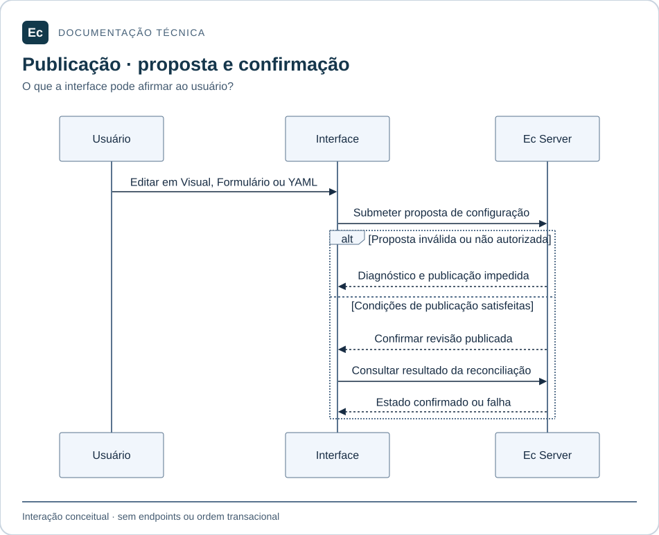

# Catálogo dos contratos do Ec

Atualização de estado em 2026-11-05: existe um incremento Rust executável de parsing/schema e CLI local de validação, com nove testes; publicação, API, PostgreSQL, Agent e frontend funcionais continuam pendentes. Consulte [estado e comandos executados](../development/first-functional-journey.md). As descrições de ausência total de código abaixo registram a baseline documental anterior e são superadas por esta atualização apenas quanto a esse incremento. O aceite de governança não é aceite de produto.

Síntese em 2026-11-04 para contribuidores de backend, Agent, frontend e testes. **Contrato vigente** aqui significa requisito documental estabelecido; não significa API, schema ou garantia de runtime implementados. A aplicação contém apenas estrutura documental. Este catálogo referencia as fontes e lacunas sem substituir as [autoridades](../constitution.md) ou decidir protocolos e assinaturas novos.

## Leitura visual

Visual, Formulário e YAML editam a mesma configuração desejada. A publicação depende de validação e autorização no backend; nenhuma projeção cria uma autoridade paralela.

[Ampliar figura](../assets/diagrams/configuration.svg) · [Fonte Mermaid](../assets/diagrams/configuration.mmd)

## Estado e fontes

| Classe | Situação neste checkout |
| --- | --- |
| Invariantes de produto | Estabelecidos pelas normas de [produto](../EC-REGRAS-DE-DESIGN-E-PRODUTO.md) e [interface](../EC-REGRAS-CRIACAO-DE-TELAS-E-IMAGENS.md) |
| Fronteiras internas e dependências | Organização documental adotada na [ADR-002](../decisions/ADR-002-application-layout.md) e no [mapa físico](application-layout.md) |
| Contratos executáveis de produto | Ausentes: sem schemas, rotas HTTP, DTOs, mensagens, migrations ou tipos de domínio implementados |
| Alternativas de transporte/durabilidade | gRPC/Protobuf e SQLite por Agent são [propostas](../ec-arquitetura-comunicacao-e-validacao.md), não decisões vigentes |
| Contratos das ferramentas locais | Implementados nos utilitários de governança e no formato de evidências; não são APIs de produto |

Os responsáveis abaixo são os módulos planejados, não serviços já disponíveis. Campos YAML como `apiVersion`, `kind`, `metadata` e `spec` são exemplos nas normas; não existe schema definitivo. JSON usado por governança/evidência ou tráfego de API não oferece configuração alternativa do Ec.

## Configuração declarativa e projeções

**Fonte:** norma de produto §§2, 14–17 e 34; norma de interface §§13–14. **Responsáveis:** `ec-server-configuration`, validadores semânticos dos domínios e frontend `configuration` com os descritores dos recursos.

- YAML é a única autoridade de configuração desejada. Visual, Formulário e YAML editam o mesmo modelo e preservam significado, referências e campos avançados.
- Recursos sem projeção visual segura mantêm acesso por formulário/YAML e uma limitação explícita. Não descartar campos desconhecidos ou de extensões silenciosamente.
- Validar sintaxe, schema/tipos, valores, referências, dependências, permissões e regras de negócio. Rejeitar chaves duplicadas, tags arbitrárias executáveis e expansões/estruturas além de limites seguros a definir.
- Listas expressam ordem semântica; ordem de chaves de mapping não determina execução. Preservação textual exata não é garantida: apresentar diff se houver regravação que altere apresentação.
- Rascunho inválido pode ser mantido como não efetivo; não pode corromper outras projeções nem ser publicado. Diagnósticos devem localizar arquivo, linha/coluna e caminho lógico, com causa/correção.

**Rejeições a demonstrar:** YAML inválido, ciclo/referência quebrada, segredo inline e perda de campo ao alternar modos. **Pendente:** schemas versionados reais, tipos de recursos, parser, limites, regras de evolução e testes de equivalência semântica.

## Publicação, concorrência e revisões

**Fonte:** norma de produto §§2, 16, 18 e 34; norma de interface §14. **Responsáveis:** `ec-server-configuration`, `ec-server-access`, domínios dos recursos e composição.

Toda alteração persistente pela UI/API deve passar pelo mesmo fluxo de validação, autorização, versionamento e publicação do YAML. O fluxo documentado é rascunho → validação → diff/impacto → autorização/aprovação aplicável → gravação versionada → reconciliação → estado efetivo.

São conceitos distintos: revisão proposta, publicada, efetiva e usada em execução. Cada publicação deve ter referência verificável de revisão/hash; cada job fixa revisões imutáveis de configuração e código. Uma edição posterior não altera execuções anteriores. Git é a preferência documental para histórico de configuração, sem backend de publicação implementado.

Conflitos concorrentes exigem resolução explícita e diff de três vias quando necessário; não usar última gravação vence silenciosamente. Projeções/cache de configuração em banco são derivados e reconstruíveis. Os estados de UI documentados são `Draft`, `Validated`, `Pending approval`, `Published`, `Reconciling`, `Synced`, `Drifted` e `Failed`; não constituem enum de API implementado.

**Rejeições a demonstrar:** publicação sem permissão, revisão base em conflito, aprovação inadequada e mudança da revisão já fixada por um job. **Pendente:** identidade/formato de revisões, armazenamento canônico concreto, fronteiras transacionais, vínculo de aprovação, controle de conflitos e recuperação de publicação interrompida.

### Interação de publicação

Sequência conceitual de responsabilidades, sem definir endpoints ou ordem transacional. Uma confirmação de publicação não equivale à configuração efetiva: a interface precisa apresentar o resultado correspondente, incluindo falha. Conflitos e aprovações seguem os requisitos desta seção.

[Ampliar figura](../assets/diagrams/publication-sequence.svg) · [Fonte Mermaid](../assets/diagrams/publication-sequence.mmd)

## Persistência e propriedade dos dados

**Fonte:** norma de produto §§2, 16 e 22; [contexto](context.md) e [organização](application-layout.md). **Responsáveis:** domínios do Server, com adaptadores conectados em `ec-server-app`.

| Informação | Autoridade planejada |
| --- | --- |
| Configuração desejada de recursos, políticas e vínculos | YAML canônico versionado |
| Fila, reservas, tentativas, leases, sessões e estado operacional | PostgreSQL no Server |
| Projeções de configuração para consulta | Estruturas derivadas e reconstruíveis do YAML |
| Logs, conteúdo de artefatos e relatórios | Armazenamento operacional apropriado, com contratos do domínio `results`; tecnologia/layout ainda não definidos |
| Credenciais reais | Subsistema/provedor de segredos e segurança; YAML guarda referências |
| Eventos/checkpoints locais do Agent | Mecanismo de durabilidade não definido; SQLite é alternativa proposta |

Crate não equivale a banco ou transação. Não inferir tabelas aplicadas a partir do modelo lógico da proposta de comunicação. **Pendente:** schema/migrations, índices, transações entre domínios, armazenamento de conteúdo, backups, retenção operacional e recuperação.

## API e fronteira Server–Agent

**Fonte:** norma de produto §§19, 20 e 22; [autoridades](../constitution.md) e [mapa físico](application-layout.md). **Responsáveis:** `ec-server-orchestration` e domínios expostos pela API; no Agent, `ec-agent-control` e `ec-agent-reporting`.

HTTP versionado é o transporte estabelecido para os contratos entre componentes. Server controla autorização, fila e decisões de estado; Agent reporta capacidades e executa trabalho autorizado. Slots/capacidades anunciados não são prova de isolamento ou capacidade efetiva. Estado de pool configurado e disponibilidade observada do Agent são distintos.

Não há endpoints, métodos, status HTTP, envelopes, DTOs, autenticação de sessão de Agent, intervalo de heartbeat ou compatibilidade entre versões formalizados como API executável. Os nomes de mensagens/RPCs e parâmetros da proposta gRPC são conceituais. Não usá-los como interface disponível.

**Rejeições a especificar e demonstrar:** comando sem autorização, versão/capacidade incompatível e tentativa obsoleta após desconexão. **Pendente:** contrato HTTP concreto, versionamento/negociação, erros, limites, deadlines, autenticação, revogação, recibos e reconciliação. TLS/mTLS e persistência de mensagens precisam de decisão e testes próprios; não estão aprovados por este catálogo.

## Projetos, pipelines e integrações

**Fonte:** norma de produto §§9, 11–12 e 18; READMEs de [projects](../../application/server/backend/crates/ec-server-projects/README.md) e [extensions](../../application/server/backend/crates/ec-server-extensions/README.md). **Responsáveis:** esses domínios, configuração, acesso e orquestração, com frontend `projects`, `pipelines` e `extensions`.

Hierarquia de projetos, herança de políticas/parâmetros e referências de recursos devem ser explícitas. Mover, excluir, arquivar ou alterar herança exige indicar impacto sobre permissões, pipelines, históricos e referências. Definições de pipeline com dependências formam DAGs; ciclos, dependências inexistentes e referências quebradas devem ser impedidos ou sinalizados. Templates/parâmetros precisam expor origem e precedência; uma alteração não reescreve revisões já fixadas.

Conexões VCS e integrações usam referências de credenciais. Distinguir repositório de código e repositório de configuração canônica quando forem diferentes; vincular disparos às revisões aplicáveis. Recepção de webhooks/eventos deve ser autenticada e autorizada, sem conceder execução arbitrária no Server. Gestão de manifests/compatibilidade de plugins e conectores preserva seus limites de confiança distintos.

**Rejeições a demonstrar:** referência inválida, ciclo, mudança de hierarquia sem controle de impacto, evento inválido e versão de extensão incompatível. **Pendente:** schemas, regras de herança/precedência, normalização e deduplicação de eventos, resolução de revisão, contratos de trigger e manifest/compatibilidade de plugins.

## Fila, tentativa, lease e execução

**Fonte:** norma de produto §§18–20, 22–23; READMEs de [orchestration](../../application/server/backend/crates/ec-server-orchestration/README.md) e [execution](../../application/agents/crates/ec-agent-execution/README.md). **Responsáveis:** `ec-server-orchestration`; Agent `control`, `workspace`, `execution` e `reporting`.

- A reserva deve respeitar dependências, requisitos, capacidade e políticas, com transações, leases, fencing e idempotência explícitos.
- Checkout e execução identificam revisões fixas. Retry cria nova tentativa sob política; efeitos em sistemas externos podem repetir e exigem proteção própria.
- Cancelamento solicitado, em andamento e confirmado são distintos. Timeout, falha de preparação, processo perdido e desconexão não podem virar sucesso por ausência de confirmação.
- Separar decisão global de alocação, preparação do workspace, ciclo de vida dos processos e entrega de resultados.
- Não prometer `exactly-once` para efeitos externos, segurança por processo separado ou recuperação de dados sem mecanismo demonstrado.

**Rejeições a demonstrar:** conclusão com lease/fence obsoleto, alocação sem elegibilidade, execução sem autorização e transição final incompatível com o resultado observado. **Pendente:** máquina de estados, IDs, épocas/fences, prazos, justiça/quotas, política de retry, pontos de commit e recuperação de falhas. O modelo sequencial de leases na pesquisa não valida a plataforma.

## Logs, testes, artefatos e cache

**Fonte:** norma de produto §20; READMEs de [results](../../application/server/backend/crates/ec-server-results/README.md), [reporting](../../application/agents/crates/ec-agent-reporting/README.md) e [workspace](../../application/agents/crates/ec-agent-workspace/README.md). **Responsáveis:** esses domínios e frontend `runs`.

Logs devem ser incrementais e correlacionados a job/step/tentativa, com ordenação, índices de chunk e reconexão. Saída produzida e recebida/confirmada são distintas. Relatórios distinguem falha de teste, build, infraestrutura e cancelamento. Artefatos requerem identidade, tamanho, tipo, integridade, origem, retenção e acesso autorizado; cache de build não é autoridade de artefatos imutáveis.

**Rejeições a demonstrar:** chunk repetido tratado incorretamente, artefato incompleto apresentado como íntegro e acesso indevido a resultados. **Pendente:** formatos/chunks, recibos, replay, mascaramento de segredos, buffering, perdas/truncamento, limites, storage, políticas de retenção e contratos de cache. A proposta de comunicação discute alternativas adicionais, sem implementá-las.

## Identidade, autorização, segredos e isolamento

**Fonte:** norma de produto §§2, 10–11, 23 e 34; norma de interface §§10–11. **Responsáveis:** `ec-server-access`, todos os domínios que executam ações, Agent `execution` e gestão/runtime de extensões.

Autorização é verificada no backend por ação, recurso e escopo, com menor privilégio e proteção contra escalonamento. YAML pode declarar políticas/papéis/vínculos, mas não autentica identidades nem guarda senhas, sessões, tokens ou chaves privadas. Credenciais são referências, materializadas de forma controlada; logs/UI não devem expor segredos.

Workloads não confiáveis e plugins externos só podem ser habilitados sob verificação e isolamento demonstrados, com limites e separação de privilégios. Plugin instalado, ativo, compatível, confiável e com erro são estados distintos. Plugins JVM TeamCity não têm compatibilidade nativa; não há execução irrestrita de DSL no Server.

**Rejeições a demonstrar:** operação negada ainda executada pelo backend, autoelevação indevida, segredo exposto e plugin sem controles exigidos. **Pendente:** mecanismo de identidade/federação e sessões, avaliação efetiva de permissões, políticas de segredos, assinatura/confiança, modelo de isolamento, plataformas e provas de contenção.

## Ambientes, aprovações e entregas

**Fonte:** norma de produto §21 e README de [delivery](../../application/server/backend/crates/ec-server-delivery/README.md). **Responsáveis:** `ec-server-delivery`, acesso, configuração, orquestração, resultados e frontend `delivery`.

Configuração de ambientes/políticas segue YAML; solicitações, decisões e histórico são operacionais. Aprovação crítica deve indicar revisão, artefato, destino, autor, riscos e política. Mudanças em destino/artefato exigem reavaliar os pressupostos da aprovação. Rollback só pode ser anunciado quando houver estratégia concreta e suportada.

**Rejeições a demonstrar:** promoção sem condições satisfeitas, aprovação desatualizada e ação sem permissão. **Pendente:** recursos/schemas de entrega, contratos de promoção e aprovação, implementações de deployment e recuperação/rollback.

## Frontend e experiência operacional

**Fonte:** ambas as normas de UI/produto; [organização do frontend](../../application/server/frontend/README.md). **Responsáveis:** `app`, `shared` e os nove domínios frontend, apoiados pelos contratos do backend.

A interface só declara salvo/publicado/sincronizado/executado após confirmação correspondente. Deve expor acesso negado, vazio, carregamento, falha parcial, conflito, drift e desconexão sem convertê-los em sucesso. Métricas informam escopo, período, unidade e atualização.

WCAG 2.2 AA é critério de referência, incluindo teclado, foco, semântica, contraste e feedback além de cor. Canvas precisa de alternativa estruturada equivalente; temas claro/escuro e responsividade devem preservar funções essenciais. Pinia não mantém configuração autoritativa paralela. Imports entre domínios seguem interfaces públicas, conforme o mapa físico.

**Rejeições a demonstrar:** sucesso antes da confirmação, descarte de campo ao editar, operação essencial acessível apenas por mouse e estado operacional enganoso. **Pendente:** componentes/tokens, implementação de rotas/estado, acessibilidade e ensaios de interação. Imagem estática ou teste com API simulada não demonstra integração da plataforma.

## Contratos executáveis da governança

Os formatos e ferramentas abaixo já existem, mas não implementam os contratos de produto descritos acima:

- [Perfil](../../config/governance/profile.json) e [auditor](../../tools/governance/validate.py): catálogo, origens, seleção, caminhos e hashes; `--require-installed` exige instalação real íntegra. A [ADR-001](../decisions/ADR-001-skills-sdd-adoption.md) delimita adoção/retenção.
- [Instalador](../../tools/governance/install_skills.py): `--check` é leitura; conflitos e destinos alheios são rejeitados; a baseline de recuperação é preservada. A [documentação de instalação](../development/skill-installation.md) mantém o procedimento.
- [Evidências SDD](../../sdd/evidence.md): schema 2 vincula observação aos hashes dos inputs. Estados `APPROVED`, `REJECTED`, `UNVERIFIED`, `INCONCLUSIVE` e `NOT APPLICABLE` têm significado próprio; ausência de evidência não implica aprovação.
- [Validador](../../sdd/tools/validate.py): estrutura, aceite e freshness são verificações distintas. Aprovação dos seis critérios de governança não aprova runtime, eficácia das skills ou adequação dos oráculos.

Comandos e resultados esperados estão no [README](../../README.md); classificação dos testes e limites, na [política](../development/testing.md).

## Pendências e manutenção

Antes de implementar uma fronteira pública, especificar inputs/outputs, tipos, identidade, estados, erros/rejeições, autorização, compatibilidade, persistência e recuperação pertinentes, com critérios e evidências na rota completa do [workflow](../../sdd/workflow.md). Este catálogo não substitui essas especificações.

gRPC/Protobuf, SQLite local, HA, plataformas, toolchains, versões, frameworks, mecanismos de isolamento, SLOs e limites de escala ainda dependem de decisões/evidências. Os números da proposta, inclusive 1.000 e 2.000 agentes, são metas de ensaio; não são suporte comprovado ou defaults.

Atualizar o catálogo quando uma norma/ADR ou implementação mudar um contrato; manter a ligação com schema/API/testes reais quando existirem. Preservar a distinção entre requisito, proposta, implementação e observação. A [validação desta revisão](../validation/application-analysis-20261104/report.md) registra a base observada.
