# Autoridades e invariantes do Ec

Este índice consolida a governança documental; não substitui as normas originais nem promove propostas a decisões implementadas.

## Leitura visual

Instruções e permissões vigentes têm precedência. Normas estabelecem requisitos; ADRs registram decisões; skills orientam o método. Pesquisa histórica não substitui essas autoridades.

[Ampliar figura](assets/diagrams/authorities.svg) · [Fonte Mermaid](assets/diagrams/authorities.mmd)

## Precedência

Respeitar instruções vigentes do usuário e permissões do ambiente. Para produto, consultar [regras de design e produto](EC-REGRAS-DE-DESIGN-E-PRODUTO.md) e [regras de telas e imagens](EC-REGRAS-CRIACAO-DE-TELAS-E-IMAGENS.md). ADRs registram decisões e seu status; SDD registra o escopo e evidências. Skills fornecem método, sem criar autoridade.
A pesquisa TeamCity permanece histórica: JSON e UI tardia nela descritos foram superados pelas normas do Ec. Não reescrever evidências históricas para aparentar atualização.

## Contratos vigentes

- Ec Server e Ec Agent: dois tipos de monólito modular Rust, com múltiplos Agents possíveis. Frontend Vue 3 + TypeScript.
- YAML é a única configuração declarativa canônica do produto; Visual/Formulário/YAML compartilham semântica, campos e revisão. JSON de evidências/governança, tráfego de API e manifests de ferramentas não são formatos alternativos de configuração Ec.
- PostgreSQL é autoridade planejada da fila e estado operacional. HTTP versionado é o transporte estabelecido. Leases/fencing e retries explícitos; sem promessa de exactly-once externo.
- Segredos por referência, autorização no backend e isolamento demonstrado antes de workloads não confiáveis/plugins externos. Processo separado não basta.
- Identidade visual própria, acessibilidade WCAG 2.2 AA como critério, estados honestos e design desde a fase inicial. Imagem não comprova interação nem integração.

## Propostas e estado

[gRPC/Protobuf, SQLite local e ensaios até 2.000 agentes](ec-arquitetura-comunicacao-e-validacao.md) continuam propostos. Não aprovar transporte, capacidade, versões ou SLOs pela instalação de skills.
Veja [contexto real](../sdd/project.md) e [decisão de integração](decisions/ADR-001-skills-sdd-adoption.md). Não importar proibição geral de unsafe, Iced, F0, toolchain, features concluídas ou autorização de publicação do Ox.
