# ADR-002 — Organização inicial da aplicação por domínios

Data: 2026-11-03. Status: adotada para a estrutura documental inicial. Não aprova contratos executáveis ou funcionamento de produto.

Correção em 2026-11-04 por instrução do usuário: Agent e Server ficam dentro de `application/`. A estrutura original e sua validação permanecem como registros históricos; a [reobservação](../validation/application-layout-20261104/report.md) registra a mudança.

Correção adicional em 2026-11-04: os testes entre componentes ficam em `application/integration/tests/`, com subpastas `integration/` e `e2e/`, conforme pedido do usuário. A [validação desta mudança](../validation/application-integration-tests-20261104/report.md) preserva a observação anterior.

## Leitura visual

Mapa de diretórios existentes: Agent, Server e testes entre componentes ficam em application/. A árvore contém documentação e marcadores, sem código de produto.

[Ampliar figura](../assets/diagrams/application-map.svg) · [Fonte Mermaid](../assets/diagrams/application-map.mmd)

## Contexto e autoridade

O pedido vigente exige `application/agents/crates/`, `application/server/backend/crates/` e frontend por domínios, cada domínio com `src/` e `tests/`. Unitários devem ficar em `src/`; integração e ponta a ponta, em `tests/` fora do src do módulo. Solicita documentação e arquivos preparados para versionamento, sem implementação funcional.

As [autoridades](../constitution.md) definem dois monólitos modulares Rust, Vue 3/TypeScript, YAML canônico, PostgreSQL operacional e HTTP versionado. Pinia é uma tecnologia explicitada pelo pedido atual. As duas normas de produto/interface fundamentam as responsabilidades, não nomes de crates.

## Alternativas e decisão

1. Manter apenas a pesquisa e um README não materializaria a organização solicitada.
2. Dividir por camadas técnicas globais ou criar um crate por entidade tornaria o local da responsabilidade de negócio menos claro e anteciparia separações sem contratos.
3. Adotar grupos de responsabilidade com composição separada atende ao pedido e permite rever limites antes da implementação. Esta é a opção escolhida.

A [organização da aplicação](../architecture/application-layout.md) registra quatro domínios Agent, oito backend, dois crates de composição e nove domínios frontend, com os READMEs como entrada local. Não criar crates genéricos de core/storage/protocol apenas por semelhança com as imagens Ox.

Exigências do usuário: caminhos principais, separação por domínios, src/tests por módulo, classificação dos testes, Vue 3/TypeScript/Pinia e documentação versionável.

Escolhas desta etapa: nomes e agrupamentos concretos, composição em ec-agent-app/ec-server-app, dois workspaces Cargo futuros e um pacote frontend, dependências acíclicas documentadas, integração entre crates no tests do crate de composição e documentação canônica em architecture/development. Podem ser revistas com evidência de implementação; não são exigências atribuídas ao usuário.

## Consequências e limites

- Um contribuidor localiza responsabilidade e teste correspondente pelo README principal e pelo módulo.
- Workspace separado não significa release ou protocolo independente. Não compartilhar crates internos entre Agent e Server por conveniência.
- Projects e orchestration evitam dividir prematuramente regras correlacionadas. Extensions separa plugins/conectores internamente e mantém seus diferentes limites de confiança.
- Adaptadores permanecem com os contratos dos domínios e são conectados na composição. Não há esquema de banco, framework HTTP ou transações definidos por esta decisão.
- Frontend expõe interfaces públicas mínimas; configuration recebe descritores, shared não contém stores de negócio e app integra rotas/contexto.
- Diretórios sem código usam .gitkeep; diretórios com documentação usam README.md. Não há Cargo.toml, package.json ou arquivos de teste fictícios.
- Há custo de manutenção de múltiplos READMEs e dois workspaces; regras comuns ficam centralizadas e são referenciadas.

## Workflow, verificação e revisão

Rota local documental conforme [workflow](../../sdd/workflow.md): não há alteração de contrato de runtime, dados persistidos, autorização ou execução concorrente. As decisões físicas reversíveis estão nesta ADR; schemas, API, transações, segurança e recuperação permanecem pendentes para a rota completa. A extensão da documentação, por si só, não exige nova feature SDD.

Skill primária: readme-lifecycle-engineering, para entradas e navegação; auxiliar: software-architecture, para agrupamentos, dependências e alternativas. Caminhos e hashes observados são registrados no [relatório desta mudança](../validation/application-layout-20261103/report.md). Não houve delegação nem instalação de skills.

Validar árvore real, arquivos que preservam diretórios, links, política de testes, dependências documentadas e verificadores de governança. A alteração de entradas vinculadas à feature governance-adoption exige nova observação e preservação de sua evidência anterior.

Revisitar quando um caso real exigir dependência cíclica, transação entre domínios, pacote compartilhado, contrato público estável ou separação de build. A estrutura não comprova isolamento, escala, exactly-once, acessibilidade ou cobertura de testes.
