# Contribuir com o Ec

Guia para mudanças no código, pesquisa e governança. Há implementação local Rust e
Vue/TS; preparação e limites estão nos guias de publicação, orquestração, Agent e
frontend. O procedimento de encerramento é a [política de verificação](task-verification.md).

## Leitura visual

Inspecione fontes e consumidores, escolha a rota pelo risco, implemente e verifique. Registre resultados e limites antes da entrega; a extensão documental não exige criar uma feature artificial.

[Ampliar figura](../assets/diagrams/contribution.svg) · [Fonte Mermaid](../assets/diagrams/contribution.mmd)

## Preparar a mudança

1. Leia [AGENTS.md](../../AGENTS.md), [estado e escopo](../../sdd/project.md), [autoridades](../constitution.md), [contexto arquitetural](../architecture/context.md) e ADRs pertinentes.
2. Localize os arquivos e consumidores afetados. Preserve alterações existentes, fontes importadas e relatórios históricos. O histórico Git está indisponível neste ambiente; não inicialize outro repositório para substituir essa informação.
3. Escolha a rota no [workflow](../../sdd/workflow.md). Reparos delimitados podem usar a rota local; mudanças de contratos, persistência, autorização, concorrência ou recuperação exigem a rota completa quando introduzem decisões materiais.
4. Selecione a skill primária pelo problema no [catálogo](../../sdd/chain/README.md) e leia o `SKILL.md` real. Disponibilidade não comprova execução; na rota completa registre caminho, contribuição e hash conforme o workflow.

## Editar no lugar certo

| Mudança | Referência de manutenção |
| --- | --- |
| Estado, pré-requisitos ou comandos disponíveis | [README principal](../../README.md), [estado](../../sdd/project.md) e guia do componente |
| Responsabilidade ou dependência de módulo | [Mapa físico](../architecture/application-layout.md) e READMEs consumidores |
| Contrato de produto | Normas/ADR pertinentes, [catálogo](../architecture/contracts.md) e feature SDD afetada |
| Localização ou execução de testes | [Política de testes](testing.md) e README da suíte |
| Pacote de skill | [Procedimento de instalação](skill-installation.md), perfil e ponte correspondente |
| Nova referência vigente | [Índice documental](../README.md) |
| Scanners, dados, imagens ou catálogo da suíte | [Contrato Toolbox/Ec](../../scripts/README.md), [plano local](../../sdd/features/scripts-verification/toolbox-completion-plan.md) e feature scripts-verification |

Documentação nova deve usar pt-BR; referências importadas conservam o idioma original. Python novo usa quatro espaços e `snake_case`; JSON de governança usa dois espaços. Cada README introduz seu escopo e aponta para políticas canônicas, evitando copiar regras comuns para todos os módulos.

Diagramas técnicos usam fonte Mermaid editável e explicação textual adjacente. Identifique o que é planejado, a fonte da figura e o que foi renderizado/inspecionado. Não trate uma imagem como prova de comportamento.

## Verificar a mudança

Após implementar e antes de concluir, siga a [política canônica](task-verification.md).
Ela concentra seleção por superfície, entrada `bash scripts/automate.sh run`,
pré-requisitos, diagnóstico, evidências e aceite com freshness. Corrija regressões
causadas pela alteração e registre resultados/limitações. Não dispense critérios da
feature por usar uma seleção parcial ou porque uma ferramenta está ausente.

Configurações, regras, receitas locais e locks reais são fontes versionadas;
artefatos privados preparados e saídas ficam nas raízes locais ignoradas, conforme
`.gitignore`. Não ignorar `.local/` inteiro nem promover um hash a evidência de
execução. A migração de scanners permanece planejada; a ponte atual não deve
escrever na Toolbox externa sob a restrição vigente. Nenhuma autorização de
verificação implica permissão para alterar outro projeto.

## Entregar e manter

Relate a mudança, fontes/ADRs, comandos e resultados observados e limitações materiais. Registre objetivo, arquivos observados e verificação no artefato já usado pelo projeto; a rota local não exige uma feature artificial.

Commit/tag exige pedido explícito e uso da ponte `commit-governance`. Conventional Commits em inglês é a convenção desta integração. Publicação exige autorização própria. PRs descrevem comportamento final, requisitos/ADRs e validação; mudanças de tela incluem evidência visual pertinente.

Ao introduzir código, fixe toolchains, manifests, contratos e runners aplicáveis, execute os comandos e só então os publique como instruções de produto.
