# Contribuir com o Ec

Guia para alterações locais neste checkout de pesquisa e governança. Não existe aplicação Ec a instalar ou iniciar. Python 3.11+ e biblioteca padrão bastam para os verificadores existentes; os testes precisam de diretório temporário gravável.

## Leitura visual

[](../assets/diagrams/contribution.svg)

Inspecione fontes e consumidores, escolha a rota pelo risco, implemente e verifique. Registre resultados e limites antes da entrega; a extensão documental não exige criar uma feature artificial.

[Ampliar figura](../assets/diagrams/contribution.svg) · [Fonte Mermaid](../assets/diagrams/contribution.mmd)

## Preparar a mudança

1. Leia [AGENTS.md](../../AGENTS.md), [estado e escopo](../../sdd/project.md), [autoridades](../constitution.md), [contexto arquitetural](../architecture/context.md) e ADRs pertinentes.
2. Localize os arquivos e consumidores afetados. Preserve alterações existentes, fontes importadas e relatórios históricos. O histórico Git está indisponível neste ambiente; não inicialize outro repositório para substituir essa informação.
3. Escolha a rota no [workflow](../../sdd/workflow.md). Reparos delimitados podem usar a rota local; mudanças de contratos, persistência, autorização, concorrência ou recuperação exigem a rota completa quando introduzem decisões materiais.
4. Selecione a skill primária pelo problema no [catálogo](../../sdd/chain/README.md) e leia o `SKILL.md` real. Disponibilidade não comprova execução; na rota completa registre caminho, contribuição e hash conforme o workflow.

## Editar no lugar certo

| Mudança | Referência de manutenção |
| --- | --- |
| Estado, pré-requisitos ou comandos disponíveis | [README principal](../../README.md), [estado](../../sdd/project.md) e guia do componente |
| Responsabilidade ou dependência de módulo | [Mapa físico](../architecture/application-layout.md) e READMEs consumidores |
| Contrato de produto | Normas/ADR pertinentes, [catálogo](../architecture/contracts.md) e feature SDD afetada |
| Localização ou execução de testes | [Política de testes](testing.md) e README da suíte |
| Pacote de skill | [Procedimento de instalação](skill-installation.md), perfil e ponte correspondente |
| Nova referência vigente | [Índice documental](../README.md) |

Documentação nova deve usar pt-BR; referências importadas conservam o idioma original. Python novo usa quatro espaços e `snake_case`; JSON de governança usa dois espaços. Cada README introduz seu escopo e aponta para políticas canônicas, evitando copiar regras comuns para todos os módulos.

Diagramas técnicos usam fonte Mermaid editável e explicação textual adjacente. Identifique o que é planejado, a fonte da figura e o que foi renderizado/inspecionado. Não trate uma imagem como prova de comportamento.

## Verificar a mudança

Execute da raiz do repositório:

```bash
python3 tools/governance/validate.py
python3 sdd/tools/validate.py --root .
python3 -m unittest discover -s tools/governance/tests -v
```

Os validadores devem retornar `PASS` e exit 0; a suíte deve terminar com `OK` e exit 0. Os testes usam cópias temporárias, incluindo casos de rejeição. Esses resultados verificam governança, não runtime, acessibilidade ou segurança do produto.

Para exigir integridade das skills instaladas e fazer o preflight sem escrita:

```bash
python3 tools/governance/validate.py --require-installed
python3 tools/governance/install_skills.py --check
```

A instalação atual íntegra deve produzir `ALREADY_INSTALLED`. Se houver divergência, confira o arquivo apontado e o procedimento de recuperação; não ajuste hashes apenas para fazer o auditor passar.

Quando uma mudança afeta inputs de evidência da feature de governança, preserve a observação anterior, reexamine os critérios afetados e registre os novos resultados conforme [evidence.md](../../sdd/evidence.md). Só então exija aceite atual:

```bash
python3 sdd/tools/validate.py --root . --require-approved --require-fresh
```

Esse gate falha diante de lacunas ou inputs alterados. `--structure-only` serve à inspeção durante o trabalho; não substitui aceite. Não regenere hashes para reutilizar silenciosamente uma observação antiga.

Confira também os links locais e as instruções alteradas. Os validadores têm escopos próprios; seu sucesso não equivale a conferir todos os links, âncoras, URLs externas ou renderização. Registre verificações não executadas como lacunas.

## Entregar e manter

Relate a mudança, fontes/ADRs, comandos e resultados observados e limitações materiais. Registre objetivo, arquivos observados e verificação no artefato já usado pelo projeto; a rota local não exige uma feature artificial.

Commit/tag exige pedido explícito e uso da ponte `commit-governance`. Conventional Commits em inglês é a convenção desta integração. Publicação exige autorização própria. PRs descrevem comportamento final, requisitos/ADRs e validação; mudanças de tela incluem evidência visual pertinente.

Ao introduzir código, fixe toolchains, manifests, contratos e runners aplicáveis, execute os comandos e só então os publique como instruções de produto.
