# Instalação das skills preparadas

As 67 skills (596 arquivos) estão instaladas em `.codex/skills/`. Em 2026-11-03, a execução autorizada do instalador fora do sandbox concluiu a migração de perfil e pontes. A preparação foi preservada para recuperação. Não foram alteradas permissões, montagens ou criados symlinks. Novas instalações continuam sujeitas às permissões reais do ambiente.

Da raiz, com Python 3.11+:

```bash
python3 tools/governance/install_skills.py --check
python3 tools/governance/install_skills.py --apply
python3 tools/governance/validate.py --require-installed
python3 sdd/tools/validate.py --root .
```

`--check` valida conteúdo e conflitos sem escrever e sem garantir permissão. `--apply` tenta instalar os 67 diretórios completos, confere hashes e atualiza perfil/pontes. Se destino existir diferente ou houver entradas alheias, recusa sobrescrever. Uma cópia interrompida antes da migração das pontes pode ser retomada: somente pacotes completos e idênticos são aceitos. A preparação é mantida como baseline; as fontes pertinentes originais estão no bundle `config/governance/sources/skills-inputs.zip`.

Não há transação atômica entre todas as pontes e perfil: interrupção durante essa migração exige inspecionar/restaurar os metadados a partir da preparação e comparar conteúdos antes de retomar. Não apagar pacotes ou sobrescrever mudanças recentes para “corrigir” o estado.

Depois da instalação, reexaminar AGENTS, README, sdd/project, sdd/README e ADR para atualizar o estado observado; reexecutar verificações e coletar novas evidências da feature. Não renovar hashes de evidências antigas. A interface pode precisar recarregar a descoberta; validar isso separadamente, sem alegar que um teste de cópia certifica descoberta.

## Leitura visual

[](../assets/diagrams/skills-lifecycle.svg)

Fontes originais, baseline de recuperação e instalação têm funções distintas. Preflight e auditoria verificam conteúdo; não demonstram eficácia da skill nem descoberta pela interface.

[Ampliar figura](../assets/diagrams/skills-lifecycle.svg) · [Fonte Mermaid](../assets/diagrams/skills-lifecycle.mmd)

## Retenção após a limpeza

`skills_to_use/` deixou de ser pré-requisito. O perfil identifica o bundle vigente e os hashes dos ZIPs retirados. Para auditar fontes, execute `python3 -B tools/governance/validate.py --require-installed`: o auditor verifica também os recursos originais das 71 candidatas. Os testes copiam esse bundle e continuam usando o baseline de preparação para exercitar instalação e recuperação.

Os scripts de auditoria em `docs/validation/skills-adoption/` são registros das sessões anteriores; dependem dos pacotes integrais daquele momento e não são o procedimento corrente. Consulte o [relatório de limpeza](../validation/workspace-cleanup-20261103/report.md) para o inventário, limites e verificações novas.

## Manutenção de technical-documentation — 2026-11-04

A refatoração solicitada acrescenta orientações Mermaid e duas referências visuais. O catálogo passa de 594 para 596 arquivos, mantendo as 67 skills. Pacote instalado e baseline de recuperação passam a ter o mesmo conteúdo revisado; a versão anterior está no backup da [revisão](../validation/documentation-skill-20261104/report.md), e os recursos originais permanecem no bundle. O perfil atualiza somente a descrição, adaptações e hashes de `files` desta skill, sem alterar `source_files`. Essa manutenção local não é instalação automática nem comprova eficácia ou descoberta pela interface.

## Retomada após interrupção

No Linux, executar novamente `python3 tools/governance/install_skills.py --apply`. O journal em `config/governance/install-journal.json` vincula cada ponte/perfil aos bytes anteriores e esperados. Não apague nem edite esse registro para contornar conflito. `--check` examina a possibilidade de retomada sem realizar escritas. A auditoria comum permanece estrita e pode falhar enquanto a migração estiver incompleta.

Execuções cooperantes usam `config/governance/install.lock` com flock não bloqueante; a segunda é rejeitada. O inode do lock permanece, mas a morte do processo libera a exclusão. Um conflito exige comparar conteúdo atual, journal e baseline e preservar a edição externa antes de qualquer resolução manual; não recalcular hashes para aceitá-la. Journal inválido/ausente não autoriza recuperar metadados divergentes.

A baseline permanece intacta. Temporários órfãos `.ec-install-*` e `.ec-metadata-*` não são instalação confirmada e não são removidos automaticamente: podem conter dados de diagnóstico. A garantia é retomada entre operações individuais em filesystem local Linux, não atomicidade de vários arquivos nem proteção contra escritor hostil concorrente.
