# Política de testes da aplicação Ec

Atualização de estado em 2026-11-05: existe um incremento Rust executável de parsing/schema e CLI local de validação, com nove testes; publicação, API, PostgreSQL, Agent e frontend funcionais continuam pendentes. Consulte [estado e comandos executados](first-functional-journey.md). As descrições de ausência total de código abaixo registram a baseline documental anterior e são superadas por esta atualização apenas quanto a esse incremento. O aceite de governança não é aceite de produto.

Estado: política de organização adotada; testes de produto não implementados. As verificações Python existentes exercitam governança. Não há cobertura, build Cargo/npm ou runner frontend de produto.

## Leitura visual

[](../assets/diagrams/test-boundaries.svg)

Cada painel indica uma fronteira de teste e seu local. Não há relação de quantidade ou cobertura entre os painéis. Somente a suíte Python de governança está implementada.

[Ampliar figura](../assets/diagrams/test-boundaries.svg) · [Fonte Mermaid](../assets/diagrams/test-boundaries.mmd)

## Classificação e localização

Escolha o menor escopo que demonstra a regra. A ferramenta usada não determina a categoria: um teste de componente pode ser unitário ou de integração conforme as fronteiras exercitadas.

| Categoria e escopo | Local | Evidência esperada quando implementado |
| --- | --- | --- |
| Unitário Rust | `<crate>/src/`, próximo ao código e sob `#[cfg(test)]` | Regra local, sem exercitar serviço externo real |
| Integração de crate | `<crate>/tests/` | Interface pública e colaboração com adaptadores/recursos explicitados |
| Integração entre crates do Agent | `application/agents/crates/ec-agent-app/tests/` | Composição e contratos internos do monólito |
| Integração entre crates do Server | `application/server/backend/crates/ec-server-app/tests/` | Composição, adaptadores e fronteiras transacionais pertinentes |
| Ponta a ponta de processo isolado | `tests/` do crate de composição | Executável real do componente, sem alegar jornada completa da plataforma |
| Unitário Vue/TypeScript | `application/server/frontend/src/domains/<dominio>/src/`, próximo ao código | Decisões locais de componente, store ou composable |
| Unitário de app/shared | Próximo ao código em `application/server/frontend/src/app/` ou `shared/` | Contrato local de composição ou elemento compartilhado |
| Integração interna de domínio frontend | `application/server/frontend/src/domains/<dominio>/tests/` | Partes do domínio colaborando pela interface pública |
| Integração entre domínios frontend | `application/server/frontend/tests/integration/` | Rotas, composição, sessão e contratos entre áreas |
| Jornada de interface | `application/server/frontend/tests/e2e/` | Fluxo de navegador, declarando se a API é real ou simulada |
| Integração entre componentes | `application/integration/tests/integration/` | Fronteira Server/Agent/frontend, com reais e substitutos identificados |
| Ponta a ponta da plataforma | `application/integration/tests/e2e/` | Jornada completa pelos componentes reais necessários |

Nomes de domínio na tabela são padrões explicativos, não diretórios literais. Unitários do produto ficam exclusivamente em seu `src/`; integração e ponta a ponta ficam em `tests/`, fora do `src/` do respectivo crate/domínio. A localização global dos domínios frontend sob `src/domains/` não muda essa regra.

Testes de governança em `tools/governance/tests/` e pesquisa histórica permanecem em seus caminhos; não são código de produto reorganizado por esta etapa.

## Casos que distinguem as categorias

- Validar localmente um ciclo de pipeline é unitário; validar o recurso pela interface pública com o pipeline de configuração é integração.
- Exercitar expiração de lease entre Server e Agent é integração entre componentes. A estrutura não define os valores de timeout nem o algoritmo.
- Abrir uma tela com respostas HTTP simuladas testa a interface e seus estados; não prova publicação ou execução real.
- Publicar configuração válida, executar no Agent e consultar resultado pelos componentes reais constitui uma candidata a jornada ponta a ponta da plataforma.
- Testes de autorização devem observar a rejeição no backend; ausência de um botão não comprova esse requisito.

Cada cenário precisa declarar dados, estado inicial, componentes reais, substituições, resultado esperado e limpeza. Reutilizar fixtures não significa duplicar a mesma asserção em várias suítes. Unitários de stores devem exercitar regras relevantes, não apenas repetir atribuições.

## Descoberta e execução futuras

No Rust, documentar os alvos de teste de cada crate e a organização dos módulos unitários ao criar os manifests. Não supor descoberta recursiva de qualquer subdiretório em `tests/`. Suites aninhadas precisam de ponto de entrada ou alvo configurado e verificado. Testes em `application/integration/tests/` precisarão de harness próprio ou comando que os registre; não pertencem automaticamente aos workspaces.

No frontend, definir padrões de descoberta separados para unitários nos `src/`, integração nos `tests/` de domínio e suítes globais. Configurar compilação, bundling e publicação para não levar testes e fixtures ao artefato de produção, especialmente porque os `tests/` de domínio ficam sob o `src/` global. Registrar ambiente DOM/navegador, dependências reais, simulações e tratamento de recursos ao selecionar o runner.

Runners, bibliotecas de teste, navegadores, plataformas, versões, bootstrap PostgreSQL e harness entre componentes permanecem pendentes. Nenhum comando de produto é apresentado como disponível nesta etapa. Criar testes vazios ou um manifest sem implementação não resolve descoberta nem cobertura.

## Verificações disponíveis agora

Com Python 3.11+ e a partir da raiz:

```bash
python3 tools/governance/validate.py
python3 sdd/tools/validate.py --root .
python3 -m unittest discover -s tools/governance/tests -v
```

- O auditor verifica integridade, links e catálogo de skills; o validador SDD verifica estrutura e vínculos de evidência.
- Os testes de governança usam cópias temporárias e verificam rejeições de entradas inválidas. Exigem um diretório temporário gravável.
- Para exigir instalação efetiva: `python3 tools/governance/validate.py --require-installed`.
- Para conferir a instalação: `python3 tools/governance/install_skills.py --check`.
- Para exigir aceite SDD e evidências atuais: `python3 sdd/tools/validate.py --root . --require-approved --require-fresh`. Deve falhar diante de lacunas ou conteúdo diferente do observado.
- `--structure-only` serve à inspeção estrutural durante trabalho em andamento; não substitui aceite e não deve ser combinado com exigência de freshness.

A localização vigente foi conferida na [auditoria dos caminhos](../validation/application-path-audit-20261104/report.md); o [relatório inicial](../validation/application-layout-20261103/report.md) preserva a observação antes das movimentações. PASS dessas verificações não certifica comportamento, segurança, acessibilidade ou desempenho do Ec.

## Manutenção

Ao introduzir uma suíte, documente local, intenção, comandos realmente executados, pré-requisitos, observações e limites. Mudanças em localização, runner ou contratos exigem rever descoberta e links. Mantenha distinção entre planejado, implementado e verificado conforme [evidence.md](../../sdd/evidence.md).

[Organização da aplicação](../architecture/application-layout.md) · [Testes da plataforma](../../application/integration/tests/README.md) · [README](../../README.md).

Os caminhos completos nesta política partem da raiz do repositório. `tests/` isolado indica o diretório do crate ou domínio citado; os testes entre componentes ficam em `application/integration/tests/`.
