# Política de testes da aplicação Ec

Estado atual: dois workspaces Rust e frontend Vue executáveis, com unitários,
harnesses HTTP/PostgreSQL e jornada Firefox. Consulte os guias de [publicação](publication.md),
[orquestração](orchestration.md), [Agent](agent.md) e [frontend](frontend.md).
O aceite de governança não é aceite de produto. Os limites dos incrementos permanecem explícitos.

## Leitura visual

Cada painel indica uma fronteira de teste e seu local. A figura preserva a baseline documental; não mede quantidade, cobertura ou estado atual de execução. Os guias vigentes descrevem as suítes implementadas.

[Ampliar figura](../assets/diagrams/test-boundaries.svg) · [Fonte Mermaid](../assets/diagrams/test-boundaries.mmd)

## Classificação e localização

Escolha o menor escopo que demonstra a regra. A ferramenta usada não determina a categoria: um teste de componente pode ser unitário ou de integração conforme as fronteiras exercitadas.

| Categoria e escopo | Local | Evidência esperada quando implementado |
| --- | --- | --- |
| Unitário Rust | `<crate>/src/`, próximo ao código e sob `#[cfg(test)]` | Regra local, sem exercitar serviço externo real |
| Integração de crate | `<crate>/tests/` | Interface pública e colaboração com adaptadores/recursos explicitados |
| Integração entre crates do Agent | `application/agents/crates/ec-agent-app/tests/` | Composição e contratos internos do monólito |
| Integração entre crates do Server | `application/server/backend/crates/ec-server-app/tests/` | Composição, adaptadores e fronteiras transacionais pertinentes |
| Ponta a ponta de processo isolado | `tests/` do crate de composição | Executável real do componente, sem alegar jornada completa da plataforma |
| Unitário Vue/TypeScript | `application/server/frontend/src/domains/<dominio>/src/`, próximo ao código | Decisões locais de componente, store ou composable |
| Unitário de app/shared | Próximo ao código em `application/server/frontend/src/app/` ou `shared/` | Contrato local de composição ou elemento compartilhado |
| Integração interna de domínio frontend | `application/server/frontend/src/domains/<dominio>/tests/` | Partes do domínio colaborando pela interface pública |
| Integração entre domínios frontend | `application/server/frontend/tests/integration/` | Rotas, composição, sessão e contratos entre áreas |
| Jornada de interface | `application/server/frontend/tests/e2e/` | Fluxo de navegador, declarando se a API é real ou simulada |
| Integração entre componentes | `application/integration/tests/integration/` | Fronteira Server/Agent/frontend, com reais e substitutos identificados |
| Ponta a ponta da plataforma | `application/integration/tests/e2e/` | Jornada completa pelos componentes reais necessários |

Nomes de domínio na tabela são padrões explicativos, não diretórios literais. Unitários do produto ficam exclusivamente em seu `src/`; integração e ponta a ponta ficam em `tests/`, fora do `src/` do respectivo crate/domínio. A localização global dos domínios frontend sob `src/domains/` não muda essa regra.

Testes de governança em `tools/governance/tests/` e pesquisa histórica permanecem em seus caminhos; não são código de produto reorganizado por esta etapa.

## Casos que distinguem as categorias

- Validar localmente um ciclo de pipeline é unitário; validar o recurso pela interface pública com o pipeline de configuração é integração.
- Exercitar expiração de lease entre Server e Agent é integração entre componentes. A estrutura não define os valores de timeout nem o algoritmo.
- Abrir uma tela com respostas HTTP simuladas testa a interface e seus estados; não prova publicação ou execução real.
- Publicar configuração válida, executar no Agent e consultar resultado pelos componentes reais constitui uma candidata a jornada ponta a ponta da plataforma.
- Testes de autorização devem observar a rejeição no backend; ausência de um botão não comprova esse requisito.

Cada cenário precisa declarar dados, estado inicial, componentes reais, substituições, resultado esperado e limpeza. Reutilizar fixtures não significa duplicar a mesma asserção em várias suítes. Unitários de stores devem exercitar regras relevantes, não apenas repetir atribuições.

## Descoberta e execução futuras

No Rust, documentar os alvos de teste de cada crate e a organização dos módulos unitários ao criar os manifests. Não supor descoberta recursiva de qualquer subdiretório em `tests/`. Suites aninhadas precisam de ponto de entrada ou alvo configurado e verificado. Testes em `application/integration/tests/` precisarão de harness próprio ou comando que os registre; não pertencem automaticamente aos workspaces.

No frontend, definir padrões de descoberta separados para unitários nos `src/`, integração nos `tests/` de domínio e suítes globais. Configurar compilação, bundling e publicação para não levar testes e fixtures ao artefato de produção, especialmente porque os `tests/` de domínio ficam sob o `src/` global. Registrar ambiente DOM/navegador, dependências reais, simulações e tratamento de recursos ao selecionar o runner.

Os runners atuais e o bootstrap descartável estão documentados nos guias dos componentes. Diretórios e testes vazios não comprovam cobertura.

## Verificações disponíveis agora

Siga a [política canônica de encerramento](task-verification.md): entrada comum,
seleção por superfície, comandos efetivos, pré-requisitos, critérios SDD, logs e limites.
O runner encadeia harnesses em sequência e reexecuta builds com failpoints antes deles.
Não executar suítes avulsas concorrentes nas portas/targets compartilhados.
Testes do runner exercitam também falhas, ferramentas ausentes e retenção de evidência.

## Regressões de scanners e fronteira do consumidor

Os contratos atuais de scanners estão no [guia nativo](../../scripts/README.md).
A migração removeu backends e ferramentas baixadas locais, preservando os critérios.
A integração nativa implementa comandos, seleção, parsers e testes de contrato;
os antigos requisitos STIC de staging/export/layout foram substituídos. A execução
depende de ferramentas centrais ativas, bases válidas e runtimes/serviços preparados.
Syft permanece medição. O [registro nativo](../validation/toolbox-native-20261108/report.md)
conserva resultados e bloqueios históricos; esta inspeção não renova seu aceite.
Na [limpeza de 09/11](../validation/cleanup-20261109/report.md), fontes de testes,
fixtures e descoberta foram preservadas; somente caches derivados foram retirados.
Nenhum teste ou script de verificação foi executado.

## Manutenção

Ao introduzir uma suíte, documente local, intenção, comandos realmente executados, pré-requisitos, observações e limites. Mudanças em localização, runner ou contratos exigem rever descoberta e links. Mantenha distinção entre planejado, implementado e verificado conforme [evidence.md](../../sdd/evidence.md).

[Organização da aplicação](../architecture/application-layout.md) · [Testes da plataforma](../../application/integration/tests/README.md) · [README](../../README.md).

Os caminhos completos nesta política partem da raiz do repositório. `tests/` isolado indica o diretório do crate ou domínio citado; os testes entre componentes ficam em `application/integration/tests/`.

## Incremento T005

[Agent real, logs, artefatos, migration 003 e recuperação](agent.md). Os contratos e evidências anteriores permanecem históricos; o endpoint result legado não certifica entrega de saída. Harnesses devem rodar em sequência por compartilharem a porta HTTP.
