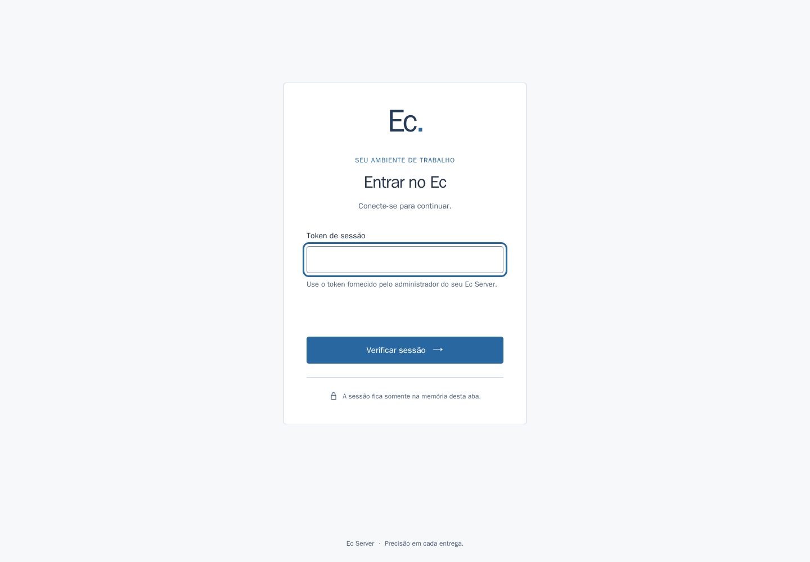
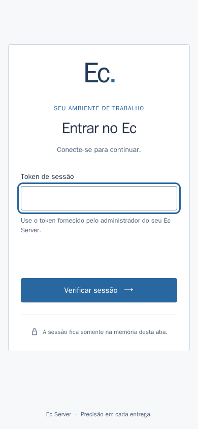
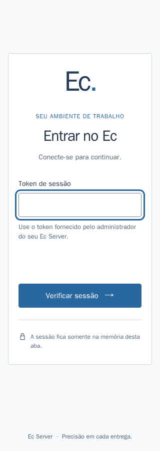
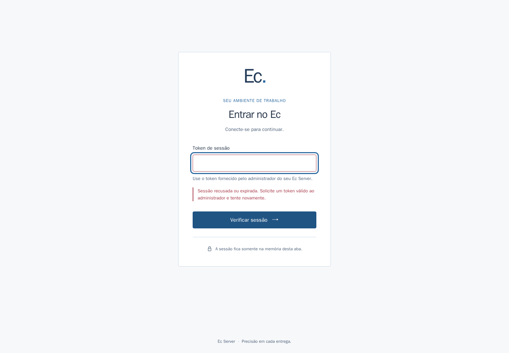
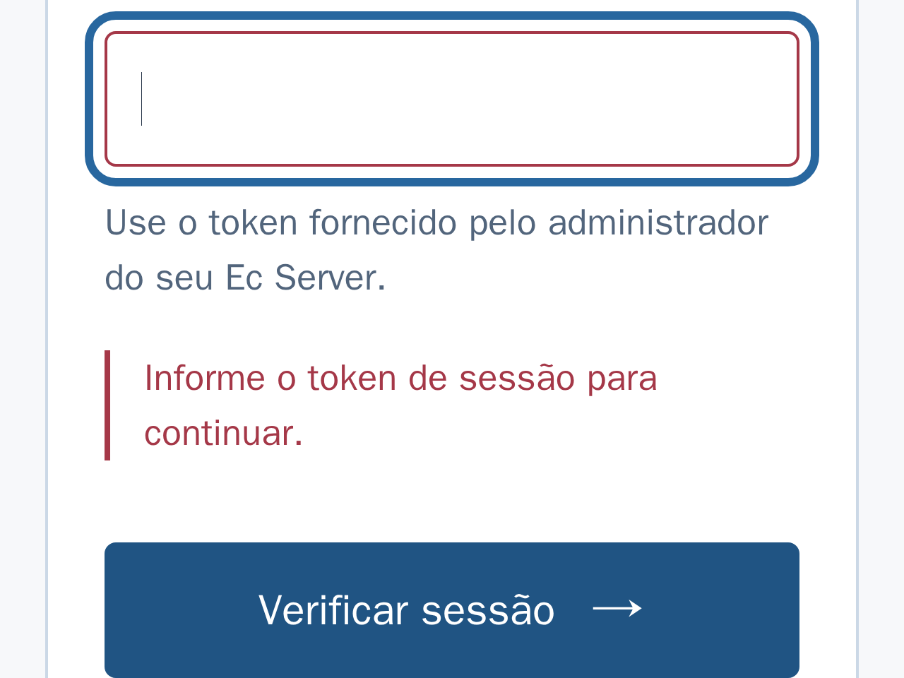

# Login Ec — observações de 15/11/2026

Reconstrução solicitada: entrada única por token, sem shell ou demonstrações. Referência visual principal: [captura oficial TeamCity](https://resources.jetbrains.com/help/img/teamcity/2025.11/spaceauth.png), versão 2021.2 EAP indicada na própria imagem; composição vertical central adaptada à identidade Ec.

## Capturas revisadas

Chromium 158.0.8127.18, Playwright local em Docker, DPR 1, tema claro, fonte fallback, build Vite atual. Fixtures de erro/sucesso são API simulada; nenhuma credencial real aparece nas capturas.

Inspeção inicial: eixo e larguras comuns, marca acima do título, margens simétricas, ausência de elementos antigos e cortes. DOM confirmou ausência de overflow em 1440, 768, 390 e 320 CSS px. Recusa devolve foco ao campo e mantém token vazio. Capturas de envio, vazio e confirmação também observadas durante execução. Revisão independente examinou código, escopo, harness e nove capturas; correção de revalidação removeu confirmação indefinida de sessão. O skip link recebeu recorte acessível após falha observada com zoom; nova captura confirmou correção. Gate atual é verificado separadamente pelo recibo final.

## Limites

A captura TeamCity é histórica, não a versão atual. Fontes IBM Plex não instaladas/comprovadas; fallback usado. Sem certificação WCAG integral ou leitor de tela. Estado do gate e evidências finais pertencem a sdd/tasks/login-rebuild.

## Ampliação e contraste

Zoom CSS 200%/400% não produziu overflow. Também foi exercitado zoom nativo Chromium via chrome.tabs.setZoom(2/4), extensão local em perfil temporário: viewport físico1280×960, innerWidth640/320 e DPR2/4. Campo, erro e botão permaneceram acessíveis com rolagem vertical; screenshot CDP da região focada abaixo. Firefox nativo200/400 não foi ensaiado, sem extrapolação de conformidade integral.

Contrastes computados contra superfície branca: texto12,46:1, secundário5,98:1, ação/foco5,95:1, erro6,44:1, atenção6,68:1 e contorno3,65:1. Fontes/font-weight efetivamente usados são fallback do navegador.

## Verificação observada

23 testes unitários e typecheck/build aprovados após revalidação. Cobertura focada relatada: linhas99,16%, funções100%, branches93,18%. O runner amplo aprovou docs/scripts, dependências Server/Agent, frontend e Playwright; sessões reais foram inicialmente bloqueadas porque a porta5173 estava ocupada. A porta canônica do harness foi separada para58140, sem interromper o servidor alheio. Diagnóstico subsequente Chromium/Firefox aprovou as sessões reais. O runner final das superfícies completas continua obrigatório. Logs específicos distinguem UI simulada e autenticação real; nenhuma credencial foi persistida em capturas.

A execução inicial em sandbox não podia escrever recibos da Toolbox externa e foi cancelada; nova execução com permissão real observou os checks. Nenhum download de dependência, commit ou publicação. O recibo final do gate permanece a autoridade de aceite, não esta narrativa.
