# Pesquisa histórica TeamCity

Material de referência preservado para o planejamento do Ec. Este diretório reúne investigação do TeamCity, utilitários e um protótipo de leases; seu conteúdo não implementa Ec Server, Ec Agent ou frontend.

## Leitura visual

Pesquisa fornece referências para análise. Requisitos e decisões do Ec continuam subordinados às autoridades vigentes; o conteúdo histórico mantém seus bytes e seu contexto.

[Ampliar figura](../docs/assets/diagrams/research-boundary.svg) · [Fonte Mermaid](../docs/assets/diagrams/research-boundary.mmd)

| Entrada | Conteúdo |
| --- | --- |
| [Pesquisa de plataforma CI](ci-platform-research/README.md) | Sínteses, validações e protótipos |
| [Engenharia reversa TeamCity](teamcity-reverse-engineering/README.md) | Metodologia, subsistemas, símbolos e lacunas |

Os READMEs internos e os relatórios mantêm o contexto original. Caminhos `rea/`, dependências de `/opt/jvm/TeamCity` e instruções antigas precisam de avaliação antes de executar; não são onboarding nem testes da governança atual.

As [autoridades do Ec](../docs/constitution.md) prevalecem para o produto: YAML canônico, design desde o início, HTTP versionado e PostgreSQL como autoridade operacional planejada. JSON como configuração Ec ou UI tardia em registros históricos não alteram essas decisões. gRPC/Protobuf e SQLite local continuam propostas.

[Documentação vigente](../docs/README.md) · [Estado do projeto](../sdd/project.md)
