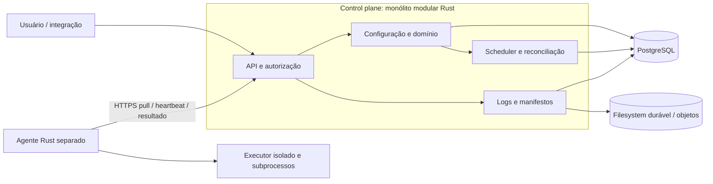

# Componentes e fronteiras

Crates propostas: domain (IDs, estados, regras puras), control (casos de uso), persistence (SQL e migrações),
transport (DTOs e auth), agent (supervisor), executor (processos e isolamento). Não criar um trait por entidade.
Traits somente em portas com alternativa real: ArtifactStore, Clock de testes, Executor.
Não compartilhar estruturas ORM ou DTOs como modelo de domínio. Erros DomainError/StorageError/TransportError
viram códigos estáveis, sem SQL, segredo ou stack trace para cliente. API: 401/403/409/413/422/429/503.

Responsabilidade persistente: PostgreSQL. Responsabilidade de executar: agente. Autoridade de resultado: controle.
Processo do job não acessa banco, token do agente, diretórios de outros jobs ou control plane administrativo.
Um slot por agente no CORE evita sobreposição local; ampliar slots exige contabilidade real de CPU/memória/disco.
