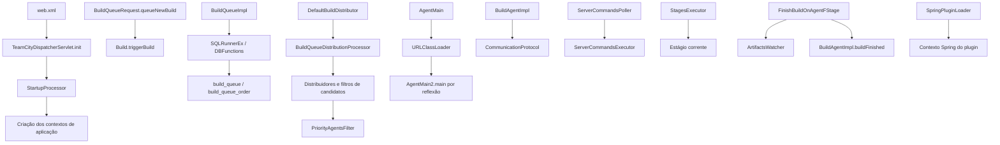

# Arquitetura observada e fronteiras

Os módulos foram observados no inventário e nos métodos referenciados em `claims.json`. As relações abaixo são estáticas; uma aresta entre processos não indica uma sessão observada.

`Build.triggerBuild → inserção na fila`, montagem dos estágios e o handler concreto servidor–agente ainda precisam de correlação completa. Essas ligações não foram desenhadas como chamadas confirmadas.
