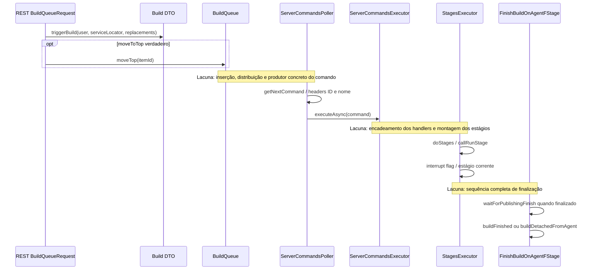

# Sequência parcial e estados

Estados comprovados localmente: flag de registro do agente, tentativa protegida por semáforo, interrupção atômica, estágio corrente, estado de término e detached. A máquina de estados global do build ainda não foi reconstruída. Não há transições globais confirmadas dinamicamente.
