# Workflow e evidências do Ec

Este diretório reúne contexto, método de trabalho, pontes para skills e registros da adoção de governança. O modelo adapta o SDD portátil 1.3.0 do pacote Ox; features, aceites e autorizações daquele produto não foram importados.

## Leitura visual

[](../docs/assets/diagrams/evidence.svg)

O critério define o que observar. Inputs e artefato identificam o conteúdo examinado; mudanças nos inputs exigem nova observação. Um hash íntegro não demonstra adequação do oracle.

[Ampliar figura](../docs/assets/diagrams/evidence.svg) · [Fonte Mermaid](../docs/assets/diagrams/evidence.mmd)

## Encontrar a referência

| Entrada | Finalidade |
| --- | --- |
| [project.md](project.md) | Estado real, escopo, stack alvo e pendências |
| [Autoridades](../docs/constitution.md) | Precedência documental e invariantes do Ec |
| [workflow.md](workflow.md) | Escolha da rota, implementação e retomada |
| [evidence.md](evidence.md) | Estados, rastreabilidade e vínculos por conteúdo |
| [chain/](chain/README.md) | Seleção das 67 especialidades por problema |
| [templates/](templates/README.md) | Modelos para features que precisam da rota completa |
| [governance-adoption](features/governance-adoption/spec.md) | Escopo e critérios da feature de governança existente |

## Escolher a rota

Use a rota local para um reparo delimitado, autorizado e recuperável, sem decisão material em aberto. Registre objetivo, arquivos observados e verificação no artefato existente; não crie spec/plan/tasks apenas para preencher pastas.

Use a rota completa quando contratos, autorização, persistência, concorrência, versões ou recuperação exigirem coordenação: **spec → plan → tasks → implementação → evidência → converge**. Quando a mudança afetar uma feature existente, atualize os artefatos e evidências afetados, inclusive na rota local.

As pontes apontam para as skills instaladas em `.codex/skills/`. Leia a entrada efetiva e use auxiliares apenas para questões distintas; uma ponte não ativa outras recursivamente. Instalação íntegra não comprova eficácia da skill.

## Verificar

A partir da raiz, com Python 3.11+:

```bash
python3 sdd/tools/validate.py --root .
```

A validação padrão exige integridade dos vínculos de evidência atuais. Para inspecionar a estrutura durante o trabalho, use `--structure-only`; esse modo não aceita a feature e não pode ser combinado com exigência de freshness.

Para exigir aceite e evidências atuais:

```bash
python3 sdd/tools/validate.py --root . --require-approved --require-fresh
```

O gate exige os seis critérios de governança aprovados ou não aplicáveis com justificativa, conforme o schema. Inputs alterados e lacunas devem produzir falha. Não renove hashes para reaproveitar silenciosamente um resultado antigo. A aprovação desses critérios não aceita o produto Ec.

As demais verificações estão no [guia de contribuição](../docs/development/contributing.md#verificar-a-mudança) e no [guia das ferramentas](../tools/governance/README.md). Consulte a [convergência](features/governance-adoption/converge.md) para o histórico e a observação vigente.

[Projeto](../README.md) · [Documentação](../docs/README.md)
