# Contexto e estado do Ec

Atualização de estado em 2026-11-05: existe um incremento Rust executável de parsing/schema e CLI local de validação, com nove testes; publicação, API, PostgreSQL, Agent e frontend funcionais continuam pendentes. Consulte [estado e comandos executados](../docs/development/first-functional-journey.md). As descrições de ausência total de código abaixo registram a baseline documental anterior e são superadas por esta atualização apenas quanto a esse incremento. O aceite de governança não é aceite de produto.

## Leitura visual

[](../docs/assets/diagrams/project-status.svg)

A linha superior registra o que existe neste checkout. A inferior apresenta trabalho pendente; não é calendário, percentual de progresso nem evidência de funcionalidades implementadas.

[Ampliar figura](../docs/assets/diagrams/project-status.svg) · [Fonte Mermaid](../docs/assets/diagrams/project-status.mmd)

## Identidade, fase e escopo

Ec é uma plataforma CI/CD de gestão abrangente. Fase observada em 2026-11-04: pesquisa, normas de produto, governança e estrutura documental da aplicação; sem aplicação implementada. A adoção de governança, a limpeza de entradas e a estrutura de Agent, Server e testes foram concluídas em seus respectivos escopos documentais. A revisão atual consolida funcionalidades, responsabilidades, implementação observada e contratos no README e em referências de arquitetura, sem iniciar funcionalidades do roadmap.
A feature de governança é [governance-adoption](features/governance-adoption/spec.md). A estrutura da aplicação segue a rota local documental, registrada na [ADR-002](../docs/decisions/ADR-002-application-layout.md) e na [auditoria atual dos caminhos](../docs/validation/application-path-audit-20261104/report.md).

## Fontes e caminhos

- [Constituição/autoridades](../docs/constitution.md), [arquitetura](../docs/architecture/context.md), [ADR](../docs/decisions/ADR-001-skills-sdd-adoption.md).
- `application/agents/crates/`: domínios e composição do Agent, apenas documentação e marcadores.
- `application/server/backend/crates/`: domínios e composição do Server, apenas documentação e marcadores.
- `application/server/frontend/`: estrutura Vue 3/TypeScript/Pinia por domínios; sem código de interface.
- `application/integration/tests/`: organização dos testes entre componentes, ainda sem cenários executáveis.
- `docs/`: normas, propostas, análise e resultados; [organização da aplicação](../docs/architecture/application-layout.md) e [testes](../docs/development/testing.md).
- [Índice documental](../docs/README.md), [visão funcional e técnica](../docs/architecture/application-overview.md) e [contratos](../docs/architecture/contracts.md): sínteses vigentes para conhecer o produto e suas lacunas.
- `reverse_engineering_teamcity/`: pesquisa histórica, utilitários e protótipo de leases.
- `config/governance/sources/skills-inputs.zip`: fontes pertinentes preservadas; `skills_to_use/` removida após a integração e auditoria de limpeza.
- `config/governance/profile.json`: catálogo, origem, arquivos/hashes e estado de instalação.
- `.codex/skills/`: 67 skills instaladas e verificadas; `.local/skill-installation/skills/`: baseline de recuperação preservado.
- `sdd/`: workflow, templates, pontes, features e validador; `tools/governance/`: auditor e instalador.

## Stack e comandos reais

Alvo: Rust Server/Agent, Vue 3/TypeScript/Pinia, PostgreSQL e HTTP versionado. Sem Cargo.toml/package.json de produto, toolchain fixada ou comandos de build/run Ec disponíveis. Git history não acessível neste ambiente. Não inicializar Git nem inventar comandos.
Da raiz, Python 3.11+ stdlib:

```bash
python3 tools/governance/validate.py
python3 sdd/tools/validate.py --root .
python3 -m unittest discover -s tools/governance/tests -v
python3 tools/governance/install_skills.py --check
```

Instalação concluída pelo instalador, com perfil e pontes migrados. `python3 tools/governance/validate.py --require-installed` exige integridade no destino real; `--apply` reconhece uma instalação íntegra como `ALREADY_INSTALLED`.
O utilitário `python3 reverse_engineering_teamcity/tools/query.py BuildQueueImpl` consulta símbolos históricos. Scripts antigos com `rea/` e gerador que lê `/opt/jvm/TeamCity` exigem pré-requisitos; não executá-los como teste desta governança.

## Decisões pendentes

Transporte gRPC, Protobuf, SQLite local, plataformas, versões, isolamento, schemas reais e limites de escala continuam pendentes. A meta de 1.000 agentes é experimental. Aceitação estrutural das skills não certifica sua eficácia, acessibilidade, segurança ou comportamento do produto.

Os caminhos listados partem da raiz do repositório. A auditoria atual abrange as duas movimentações; as observações anteriores permanecem preservadas.

A [análise documental de 2026-11-04](../docs/validation/application-analysis-20261104/report.md) registra a revisão de funcionalidades/implementações/contratos e a reobservação dos critérios de governança afetados pelas novas entradas. Não constitui aceite de produto.

## Entradas documentais revisadas — 2026-11-04

O [README principal](../README.md) apresenta o produto e o primeiro check. O [mapa da aplicação](../application/README.md) encaminha para componentes e módulos; o [guia de contribuição](../docs/development/contributing.md) concentra preparação, verificação e entrega. As [ferramentas](../tools/governance/README.md) e a [pesquisa histórica](../reverse_engineering_teamcity/README.md) têm entradas próprias. A [revisão documental](../docs/validation/documentation-refresh-20261104/report.md) registra esta reorganização, preservando os registros anteriores e distinguindo inspeção, execução e renderização.

A [refatoração visual enterprise](../docs/validation/documentation-enterprise-20261104/report.md) registra a revisão atual das entradas, mapas e guias, com fontes editáveis e inspeção visual local. Os registros anteriores permanecem preservados.
