# Ferramentas de governança

Utilitários Python executáveis para catálogo, integridade, instalação de skills e testes de rejeição. Não implementam Ec Server ou Ec Agent.

## Leitura visual

Fontes originais, baseline de recuperação e instalação têm funções distintas. Preflight e auditoria verificam conteúdo; não demonstram eficácia da skill nem descoberta pela interface.

[Ampliar figura](../../docs/assets/diagrams/skills-lifecycle.svg) · [Fonte Mermaid](../../docs/assets/diagrams/skills-lifecycle.mmd)

## Executar

Pré-requisitos: Python 3.11+, biblioteca padrão e, para testes, diretório temporário gravável. Os caminhos dos comandos abaixo partem da raiz do repositório.

| Comando | Efeito e resultado esperado |
| --- | --- |
| `python3 tools/governance/validate.py` | Auditoria de leitura: catálogo, fontes, hashes, pontes e links cobertos; `PASS` e exit 0 quando íntegro |
| `python3 tools/governance/validate.py --require-installed` | Exige também instalação efetiva íntegra no destino declarado |
| `python3 tools/governance/install_skills.py --check` | Preflight sem escrita; instalação atual íntegra resulta em `ALREADY_INSTALLED` |
| `python3 -m unittest discover -s tools/governance/tests -v` | Suíte em cópias temporárias; `OK` e exit 0 quando os cenários passam |

O instalador também possui modo de aplicação com escrita. Consulte o [procedimento canônico](../../docs/development/skill-installation.md) antes de usá-lo: o catálogo já está instalado, e repetir uma instalação não é etapa de onboarding.

## Arquivos e falhas

[validate.py](validate.py) lê o [perfil](../../config/governance/profile.json), confere os pacotes e a preservação das fontes. [install_skills.py](install_skills.py) rejeita conflitos e destinos alheios. A [suíte](tests/test_governance.py) exercita controles de rejeição e instalação idempotente.

Uma divergência exige examinar o arquivo e sua origem; não renovar hashes para encobri-la. A baseline em `.local/skill-installation/skills/` é preservada para recuperação. Falha por diretório temporário indisponível deve ser tratada no ambiente antes de interpretar o resultado da suíte.

O validador [SDD](../../sdd/README.md) verifica outro contrato: estrutura, rastreabilidade e evidências. Nenhuma dessas ferramentas certifica eficácia das skills, comportamento ou conformidade do produto.

[Contribuição](../../docs/development/contributing.md) · [Política de testes](../../docs/development/testing.md) · [Projeto](../../README.md)
